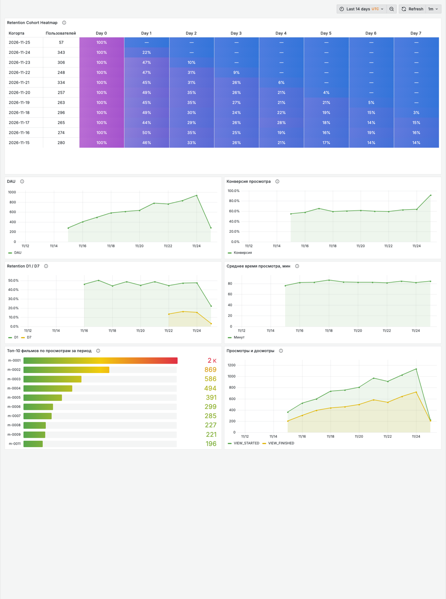

# ДЗ 5. Online Cinema: Event Streaming + Analytics Pipeline

Конвейер аналитики онлайн-кинотеатра. **Movie Service** принимает события по HTTP и генерирует синтетический поток, публикует их в Kafka (Avro + Schema Registry). **ClickHouse** читает топик движком Kafka и хранит сырые события. **Aggregation Service** по расписанию считает бизнес-метрики в ClickHouse и выгружает их в **PostgreSQL**, а оттуда раз в день в **S3 (MinIO)**. **Grafana** строит дашборд по агрегатам.

Условие задания: [`docs/hw5-assignment.md`](docs/hw5-assignment.md). ДЗ 1–4 лежат в ветках [`hw1`](../../tree/hw1), [`hw2`](../../tree/hw2), [`hw3`](../../tree/hw3), [`hw4`](../../tree/hw4).

**Стек:** Python 3.12, FastAPI, `confluent-kafka` (librdkafka) + Schema Registry client, `fastavro`, Apache Kafka 3.9.1 (KRaft), Confluent Schema Registry 7.9.1, ClickHouse 24.8, PostgreSQL 16 + Flyway, MinIO, Grafana 11.6 + плагин ClickHouse 4.23.5, `clickhouse-connect`, `psycopg` 3, `boto3`, pytest.

```
                      HTTP POST /api/v1/events
                                │
                   ┌────────────▼────────────┐
                   │      Movie Service      │  валидация (Pydantic + схема Avro), генератор
                   │  producer: acks=all,    │
                   │  idempotence, retry     │
                   └────────────┬────────────┘
                     key=user_id│ Avro (Confluent wire format)
        ┌───────────────────────▼──────────────────────┐        ┌─────────────────┐
        │ Kafka: kafka-1, kafka-2 (брокеры) +          │◀──────▶│ Schema Registry │
        │ kafka-controller; movie-events: 3 партиции,  │        │ movie-events-   │
        │ RF=2, min.insync.replicas=1                  │        │ value: v1, v2   │
        └───────────────────────┬──────────────────────┘        └────────┬────────┘
                                │ Kafka Engine (AvroConfluent) ◀─────────┘
        ┌───────────────────────▼──────────────────────┐
        │ ClickHouse: movie_events_queue ─MV─▶ movie_events (ReplacingMergeTree)
        │                                 └─MV─▶ movie_events_dlq (ошибки разбора)
        │ movie_events ─MV─▶ user_daily_activity        │
        │ agg_daily_metrics, agg_top_movies,           │◀── Grafana (пользователь grafana:
        │ agg_retention_cohort                         │    SELECT только на agg_*)
        └──────────▲───────────────────────────────────┘
          SELECT / │ INSERT … SELECT
        ┌──────────┴────────────┐  UPSERT   ┌────────────┐  JSON  ┌──────────────────────────────┐
        │  Aggregation Service  ├──────────▶│ PostgreSQL ├───────▶│ MinIO: s3://movie-analytics/ │
        │ расписание + HTTP     │           │ (метрики)  │        │ daily/YYYY-MM-DD/            │
        └───────────────────────┘           └────────────┘        │ aggregates.json              │
                                                                  └──────────────────────────────┘
```

---

## 1. Быстрый старт

Нужен только Docker (Compose v2). Порты на хосте: 3000, 5436, 8000, 8001, 8081, 8123, 9000, 9001, 9002, 9092, 9094.

```bash
docker compose up --build        # или make up: то же в фоне с ожиданием healthcheck
```

Порядок запуска (через `depends_on` и healthcheck, без ручных шагов):

1. `kafka-1`, `kafka-2`, `kafka-controller` → `schema-registry`.
2. `pipeline-init` (однократно): создаёт топик `movie-events` и регистрирует схемы v1, v2.
3. `clickhouse` → `clickhouse-migrations` (однократно): таблицы, Kafka Engine, materialized views.
4. `postgres` → `postgres-migrations` (Flyway). Параллельно стартует `minio`.
5. `movie-service`: загружает историю за 10 дней, затем переходит к потоку в реальном времени.
6. `aggregation-service`: первый цикл через 15 с, затем каждые 60 с. `grafana`.

Через ~1 минуту после старта дашборд заполнен: http://localhost:3000.

| Что | Адрес | Доступ |
|---|---|---|
| Grafana, дашборд «Online Cinema — аналитика» | http://localhost:3000 | анонимный просмотр; admin / admin |
| Movie Service API, Swagger UI | http://localhost:8000, http://localhost:8000/docs | — |
| Aggregation Service API, Swagger UI | http://localhost:8001, http://localhost:8001/docs | — |
| ClickHouse HTTP / native | `localhost:8123` / `localhost:9000` | cinema / cinema |
| Schema Registry | http://localhost:8081 | — |
| Kafka с хоста | `localhost:9092` (kafka-1), `localhost:9094` (kafka-2) | — |
| PostgreSQL (метрики) | `localhost:5436`, БД `analytics` | analytics / analytics |
| MinIO API / консоль | http://localhost:9002 / http://localhost:9001 | minioadmin / minioadmin |

Учётные данные — только для локального запуска.

```bash
# Событие через HTTP API
curl -s -X POST localhost:8000/api/v1/events -H 'Content-Type: application/json' -d '{
  "user_id": "demo-user", "movie_id": "m-0001", "event_type": "VIEW_STARTED",
  "device_type": "TV", "session_id": "demo-session", "progress_seconds": 0}'
# {"event_id":"9d16f45a-…","topic":"movie-events","partition":2,"offset":24926,"schema_version":2}

# Пересчёт метрик за день и экспорт в S3
curl -s -X POST 'localhost:8001/api/v1/aggregations/recompute?date=2026-11-24'
curl -s -X POST 'localhost:8001/api/v1/exports?date=2026-11-24'
```

### Тесты

```bash
make test            # 47 интеграционных тестов, п. 1–8; поднимает систему, если она не запущена (~15 с на работающей системе)
make test-failover   # п. 8: останавливает kafka-1, 2 теста на работу с одним брокером, запускает kafka-1 обратно
```

Тесты выполняются в контейнере `tests` (профиль `test` в `docker-compose.yml`) в сети compose. На хосте нужны только Docker и `make`; без `make`: `docker compose --profile test run --rm --build tests`.

Повторяемость: каждый тест работает со своими `user_id`, после теста их события удаляются. Набор для проверки метрик лежит на изолированных датах 2001-02-22…2001-03-11; до и после тестов эти даты очищаются в ClickHouse, PostgreSQL и S3. Генератор и плановые циклы эти даты не трогают.

Остановка: `docker compose down`, с удалением данных: `docker compose down -v` (`make reset`).

---

## 2. Структура

```
.
├── docker-compose.yml                 # 13 сервисов + tests (профиль test)
├── Makefile                           # up, down, reset, logs, test, test-failover
├── schemas/movie_event.v{1,2}.avsc    # схемы Avro, регистрируются в Schema Registry
├── movie-service/                     # п. 2
│   └── app/
│       ├── main.py                    # HTTP API: POST /api/v1/events, GET /api/v1/generator, /health
│       ├── events.py                  # модель запроса и правила, которые не выражаются схемой Avro
│       ├── publisher.py               # Kafka-продюсер: Avro-сериализация, acks=all, повторы с backoff
│       ├── generator.py               # генератор пользователей, сессий и событий
│       ├── bootstrap.py               # pipeline-init: топик + регистрация схем (п. 1)
│       └── config.py, logging_setup.py
├── clickhouse/
│   ├── migrations/V00{1..4}__*.sql    # п. 3 и таблицы агрегатов п. 5; пользователь grafana
│   ├── migrate.sh                     # применяет миграции, ведёт cinema.schema_migrations
│   └── config.d/cinema.xml            # UTC, earliest offset для Kafka Engine
├── aggregation-service/               # п. 5, 7
│   ├── migrations/V1__aggregates_schema.sql   # PostgreSQL (Flyway)
│   └── app/
│       ├── main.py                    # планировщик + HTTP API
│       ├── queries.py                 # SQL метрик (ClickHouse)
│       ├── aggregator.py              # цикл: ClickHouse → агрегаты → PostgreSQL
│       ├── storage.py                 # идемпотентная запись в PostgreSQL
│       ├── exporter.py                # экспорт в S3
│       └── retry.py, config.py, logging_setup.py
├── grafana/
│   ├── Dockerfile                     # Grafana + плагин ClickHouse, установленный при сборке
│   ├── provisioning/                  # datasource ClickHouse, провайдер дашбордов
│   └── dashboards/cinema.json         # п. 6
├── tests/                             # pytest: test_1 … test_6
└── docs/
    ├── hw5-assignment.md              # условие
    └── img/                           # схемы из условия, скриншот дашборда
```

---

## 3. Пункт 1. Топик и схема событий

### Схема Avro

[`schemas/movie_event.v1.avsc`](schemas/movie_event.v1.avsc) — обязательные поля из условия; [`v2`](schemas/movie_event.v2.avsc) добавляет необязательное `search_query` (текст запроса у `SEARCHED`).

| Поле | Avro | ClickHouse |
|---|---|---|
| `event_id` | `string`, logicalType `uuid` | `UUID` |
| `user_id`, `movie_id`, `session_id` | `string` | `String` |
| `event_type` | `enum EventType` (6 значений) | `Enum8` |
| `timestamp` | `long`, logicalType `timestamp-millis` (UTC) | `DateTime64(3, 'UTC')` |
| `device_type` | `enum DeviceType` (4 значения) | `Enum8` |
| `progress_seconds` | `["null", "int"]`, default `null` | `Nullable(Int32)` |
| `search_query` (v2) | `["null", "string"]`, default `null` | `Nullable(String)` |

`progress_seconds` допускает `null`, потому что у `LIKED` и `SEARCHED` позиции воспроизведения нет. Правило «у `VIEW_*` поле обязательно, у остальных отсутствует» проверяет продюсер (§4).

### Регистрация и версии

Контейнер `pipeline-init` (`python -m app.bootstrap`) при каждом старте идемпотентно:

1. ставит субъекту `movie-events-value` режим совместимости `BACKWARD`;
2. проверяет совместимость и регистрирует `v1`, затем `v2`. Schema Registry присваивает им версии 1 и 2 (id 1 и 2);
3. Продюсер сериализует версией из `SCHEMA_VERSION` (по умолчанию `latest` = 2) с `auto.register.schemas=false`: незарегистрированной схемой писать нельзя.

`BACKWARD`: новая версия обязана читать данные старой. Добавление поля с default (v1 → v2) проходит. Добавление обязательного поля Schema Registry отклоняет с HTTP 409 (тест `test_incompatible_schema_change_is_rejected`). ClickHouse читает обе версии: id схемы в сообщении, сама схема из Registry; у сообщений v1 `search_query = NULL` (тест `test_message_written_with_schema_v1_is_readable`).

```bash
curl -s localhost:8081/subjects/movie-events-value/versions        # [1,2]
curl -s localhost:8081/config/movie-events-value                   # {"compatibilityLevel":"BACKWARD"}
```

### Топик

`movie-events`: 3 партиции, `replication.factor=2`, `min.insync.replicas=1`, `retention.ms` = 7 суток, `cleanup.policy=delete`. На брокерах `auto.create.topics.enable=false`: топик создаётся только явно, с заданной конфигурацией. Если топик уже есть, `bootstrap` сверяет число партиций, RF и `min.insync.replicas` и падает, если они слабее требуемых.

### Ключ партиционирования: `user_id`

- **Порядок внутри сессии.** Kafka гарантирует порядок только в партиции. Сессия принадлежит одному пользователю, поэтому `VIEW_STARTED → VIEW_PAUSED → VIEW_RESUMED → VIEW_FINISHED` одного пользователя читаются в порядке записи (тест `test_user_events_share_partition_and_keep_order`). С ключом `movie_id` события одного пользователя по разным фильмам разошлись бы по партициям.
- **Равномерность.** Популярность фильмов подчиняется степенному закону: у генератора самый популярный фильм собирает ~20% просмотров (см. топ на дашборде). С ключом `movie_id` премьера перегрузила бы одну партицию. Пользователей на порядки больше, чем фильмов, и вклад одного пользователя мал.
- **Метрики по пользователю** (DAU, retention, сессии) считаются по `user_id`; при росте потребителей Kafka Engine каждый пользователь обрабатывается одним потребителем.

Цена: нет порядка событий одного фильма между пользователями. Метрикам он не нужен.

---

## 4. Пункт 2. Продюсер (Movie Service)

### HTTP API

`POST /api/v1/events` — тело JSON с полями схемы. `event_id` и `timestamp` необязательны: если их нет, сервис ставит UUIDv4 и время приёма. Ответ отправляется после подтверждения записи брокером.

| Код | Когда | Тело |
|---|---|---|
| 202 | событие записано в Kafka | `{"event_id", "topic", "partition", "offset", "schema_version"}` |
| 422 | событие не проходит проверку | `{"error": "VALIDATION_ERROR", "message", "details": [{"field", "message"}]}` |
| 503 | Kafka не подтвердила запись после всех попыток | `{"error": "PUBLISH_FAILED", …}` |

Проверки перед отправкой:

1. **Типы и формат** (Pydantic): обязательные поля, UUID, значения перечислений, `timestamp` в ISO 8601 с часовым поясом, `0 ≤ progress_seconds ≤ 2^31−1` (Avro `int`), неизвестные поля запрещены.
2. **Правила между полями**: `progress_seconds` обязателен для `VIEW_*` и запрещён для `LIKED`/`SEARCHED`; `search_query` только у `SEARCHED`; `timestamp` не позже, чем на 5 мин в будущем.
3. **Схема Avro**: запись проверяется `fastavro.validation` по схеме, полученной из Schema Registry.

### Kafka-продюсер ([`publisher.py`](movie-service/app/publisher.py))

| Требование | Реализация |
|---|---|
| Ключ партиционирования | `key = user_id` |
| Подтверждение записи | `acks=all`, `enable.idempotence=true`: подтверждение после записи на все реплики из ISR; внутренние повторы librdkafka без дублей и без перестановок в партиции |
| Повторы с exponential backoff | 1) librdkafka: `retry.backoff.ms=100` → `retry.backoff.max.ms=1000` в пределах `delivery.timeout.ms=10000`; 2) приложение: до `PUBLISH_MAX_ATTEMPTS=5` попыток, задержка `min(5000, 200 · 2^(n−1))` мс × случайный множитель [0.5, 1] |
| Логирование публикации | JSON-строка на каждое событие: `event_id`, `event_type`, `timestamp`, `user_id`, `partition`, `offset`, номер попытки |

```json
{"ts": "2026-11-25T10:35:22.013Z", "level": "INFO", "logger": "movie_service.publisher", "msg": "event published", "event_id": "8e6f5587-5df5-514a-abd0-33ffea461a15", "event_type": "VIEW_RESUMED", "timestamp": "2026-11-25T10:35:22.000Z", "user_id": "u-20261125-0007", "partition": 0, "offset": 24407, "attempt": 1}
```

Повтор уровня приложения после таймаута доставки может записать событие второй раз. Это осознанный выбор: доставка at-least-once, дубликаты убирает ClickHouse по `event_id` (§5).

Колбэки доставки librdkafka вызываются в отдельном потоке `poll()`. Результат передаётся в event loop через `concurrent.futures.Future`, поэтому HTTP-обработчик не блокируется.

### Генератор ([`generator.py`](movie-service/app/generator.py))

Все данные генератора **вымышлены** и нужны для демонстрации. Каталог: 40 фильмов (`m-0001`…) длительностью 20–55 мин (эпизоды) и 85–160 мин (фильмы), популярность по закону Ципфа.

- **Пользователи.** Каждый день приходит когорта новых пользователей (300 ± 20%). Пользователь когорты C активен в день C + k с вероятностью `stickiness · 0.55 · k^−0.45`, где `stickiness ~ U(0.35, 1)`. Это даёт D1 около 45–50% и D7 около 15%.
- **Сессия:** с вероятностью 35% `SEARCHED` → `VIEW_STARTED` (progress 0) → 0–3 пары `VIEW_PAUSED`/`VIEW_RESUMED` (progress на паузе и продолжении равен, пауза 20–900 с) → `VIEW_FINISHED` (progress = длительность, вероятность 62%), затем с вероятностью 30% `LIKED`; иначе сессия обрывается на `VIEW_PAUSED`. Время событий согласовано с позицией воспроизведения: между паузами проходит ровно столько секунд, сколько добавилось к `progress_seconds`.
- **Режимы.** При старте публикуются события за `GENERATOR_BACKFILL_DAYS=10` прошедших дней и сегодняшние до текущего момента (около 38 тыс. событий за ~4 с). Лог каждого события — `DEBUG`, по дню — `INFO`. Затем остальные события публикуются в момент своего `timestamp`, лог каждого — `INFO`.
- **Детерминизм.** Пользователи, сессии и `event_id` (UUIDv5) выводятся из `GENERATOR_SEED`, даты и пользователя. Перезапуск в тот же день публикует те же события с теми же `event_id`, ClickHouse схлопывает дубликаты.

Реалистичность проверяет тест `test_generator_sessions_are_realistic` по данным в ClickHouse: нет сессий, где `VIEW_FINISHED` без `VIEW_STARTED` или раньше него; `progress_seconds` в каждой сессии не убывает; `VIEW_STARTED` всегда с позиции 0.

Отключить генератор: `GENERATOR_ENABLED=false docker compose up`. Статус: `GET /api/v1/generator`.

---

## 5. Пункт 3. ClickHouse: приём и хранение

Миграции: [`clickhouse/migrations`](clickhouse/migrations), применяет их `clickhouse-migrations` ([`migrate.sh`](clickhouse/migrate.sh)). Применённые файлы записываются в `cinema.schema_migrations`, повторный старт их пропускает. Адреса брокеров и Schema Registry подставляются из окружения.

| Таблица | Движок | Назначение |
|---|---|---|
| `movie_events_queue` | `Kafka`, формат `AvroConfluent` | читает `movie-events`, группа `clickhouse-movie-events` |
| `movie_events_consumer` | Materialized View | корректные сообщения → `movie_events`, плюс `_partition`, `_offset`, `ingested_at` |
| `movie_events` | `ReplacingMergeTree` | постоянное хранение сырых событий |
| `movie_events_dlq_consumer` → `movie_events_dlq` | MV → `MergeTree`, TTL 30 дней | сообщения, которые не удалось разобрать: сырые байты и текст ошибки |
| `user_daily_activity_mv` → `user_daily_activity` | MV → `ReplacingMergeTree` | пары (пользователь, день активности) для retention |

**`movie_events`.**

- `PARTITION BY toYYYYMM(event_date)`: месячные партиции; старые данные удаляются целой партицией, запрос за день читает одну партицию.
- `ORDER BY (event_date, event_type, user_id, event_id)`: все запросы агрегации фильтруют по дню и типу события (`countIf(event_type = 'VIEW_STARTED')`, `avgIf(…, 'VIEW_FINISHED')`), первичный индекс отсекает гранулы других дней. Внутри дня данные отсортированы по пользователю, что ускоряет `uniqExact(user_id)`.
- `event_date` — `MATERIALIZED toDate(timestamp)` в UTC (сервер настроен на `UTC`).
- **Дедупликация.** Повторная доставка одного события совпадает по всему ключу сортировки, включая `event_id`. `ReplacingMergeTree` схлопывает такие строки при вставке и слияниях, запросы агрегации читают с `FINAL` (тест `test_duplicate_delivery_is_collapsed`).

**Устойчивость приёма.** `kafka_handle_error_mode='stream'`: битое сообщение не останавливает потребителя, а попадает в `movie_events_dlq` (тест `test_malformed_message_goes_to_dead_letter_table`). `input_format_avro_allow_missing_fields=1` позволяет читать сообщения схемы v1. `kafka_flush_interval_ms=1000`: событие появляется в таблице примерно через 1–2 с.

**Соответствие схеме п. 1.** Столбцы `movie_events_queue` совпадают с полями схемы последней версии по именам, порядку и типам (тест `test_clickhouse_schema_matches_avro_schema`).

---

## 6. Пункт 4. Интеграционный тест конвейера

[`tests/test_3_pipeline.py`](tests/test_3_pipeline.py): тест публикует событие через HTTP API продюсера, ждёт строку в ClickHouse (до 60 с) и сравнивает все поля: `event_id`, `user_id`, `movie_id`, `event_type`, `timestamp` с точностью до миллисекунд, `event_date`, `device_type`, `session_id`, `progress_seconds`, `search_query`, а также `partition` и `offset` из ответа продюсера. Там же проверяются порядок событий одной сессии, дедупликация, совместимость v1, DLQ и соответствие схем.

Повторяемость: уникальные `user_id` на каждый запуск, после теста события удаляются (`DELETE FROM cinema.movie_events WHERE user_id IN …`). Запуск одной командой: `make test`.

---

## 7. Пункт 5. Сервис агрегации

### Работа сервиса

- Отдельный контейнер `aggregation-service`. Читает сырые события только из ClickHouse, с продюсером и Kafka не связан.
- **Расписание:** каждые `AGG_INTERVAL_SECONDS` (по умолчанию 60) пересчитываются дни `[сегодня − AGG_LOOKBACK_DAYS, сегодня]`, по умолчанию 8 дней. Так D7 когорты недельной давности и поздно пришедшие события попадают в метрики. Первый цикл после старта захватывает `AGG_INITIAL_LOOKBACK_DAYS=30` дней, чтобы досчитать уже накопленную историю. Плановый и ручной пересчёты не выполняются одновременно (блокировка).
- **Ручной пересчёт за день:** `POST /api/v1/aggregations/recompute?date=YYYY-MM-DD`. Ответ:
  ```json
  {"trigger":"http","date_from":"2026-11-24","date_to":"2026-11-24","raw_events":5331,"clickhouse_rows_read":32845,"postgres_rows_written":64,"computed_at":"2026-11-25T10:35:28.782Z","duration_seconds":0.054}
  ```
- **Логи цикла:** начало и конец, число сырых событий в окне, строк прочитано в ClickHouse, строк записано в PostgreSQL, длительность.
  ```json
  {"ts": "2026-11-25T10:34:57.613Z", "level": "INFO", "logger": "aggregation.cycle", "msg": "aggregation cycle started", "trigger": "schedule", "date_from": "2026-11-17", "date_to": "2026-11-25"}
  {"ts": "2026-11-25T10:34:57.712Z", "level": "INFO", "logger": "aggregation.cycle", "msg": "aggregation cycle finished: processed 33680 events, wrote 244 rows in 0.099 s", "raw_events": 33680, "clickhouse_rows_read": 88561, "postgres_rows_written": 244, "duration_seconds": 0.099, …}
  ```
- `GET /api/v1/metrics?date=` — готовые метрики дня из PostgreSQL.

### Метрики

Все дни — календарные дни UTC. «Активность» — любое событие пользователя.

| Метрика (`metric_name`) | Определение | Единица |
|---|---|---|
| `dau` | `uniqExact(user_id)` за день | пользователи |
| `avg_watch_time_seconds` | `avgIf(progress_seconds, event_type = 'VIEW_FINISHED')`; `NULL`, если досмотров не было | секунды |
| `view_conversion` | `countIf(VIEW_FINISHED) / countIf(VIEW_STARTED)` за день; `NULL`, если не было запусков | доля 0..1 |
| `retention_d1` за день D | доля когорты D−1, активной в день D | доля 0..1 |
| `retention_d7` за день D | доля когорты D−7, активной в день D | доля 0..1 |
| топ фильмов | `row_number() OVER (PARTITION BY день ORDER BY views DESC, unique_viewers DESC, movie_id)`, где `views = countIf(VIEW_STARTED)`; плюс уникальные зрители, досмотры, лайки | ранг, события |
| вспомогательные | `events_total`, `sessions` (`uniqExact(session_id)`), `views_started`, `views_finished`, `likes`, `searches` | события, сессии |
| когорты (п. 6) | `cohort_size`, `retained_users`, `retention_rate` для дней жизни 0..7 | пользователи, доля |

Решения, которые условие оставляет автору:

- **Когорта** — день первой активности пользователя. Для неё нужна полная история пользователя, поэтому она берётся из компактной `user_daily_activity` (одна строка на пользователя и день), а не из сырых событий. Дата первой активности вычисляется оконной функцией `min(activity_date) OVER (PARTITION BY user_id)`, дни жизни — через `groupUniqArray(dateDiff(…))` и `ARRAY JOIN range(8)`.
- **Retention — по дню возврата.** `retention_d1` и `retention_d7` относятся к дню D, когда пользователи вернулись, а не к дню когорты. Значение дня D окончательно сразу после конца дня D, поэтому ежедневный экспорт «итоговых метрик за прошедший день» (п. 7) полон. Ретроспектива по когортам — в heatmap (п. 6).
- **Ячейки будущего.** Ячейка когорты (C, N) записывается, только если день C + N наступил. Ещё не наступившие дни остаются пустыми, а не 0%.
- **Метрики за сегодня неполные:** они пересчитываются каждую минуту до конца дня.

### Материализация в ClickHouse

Метрики вычисляет ClickHouse через `INSERT … SELECT` ([`queries.py`](aggregation-service/app/queries.py)) в три таблицы `ReplacingMergeTree(computed_at)`: `agg_daily_metrics` (день, метрика), `agg_top_movies` (день, фильм) и `agg_retention_cohort` (когорта, день жизни). Повторный пересчёт вставляет строки с новым `computed_at`, и при чтении с `FINAL` остаётся последняя версия. Сервис читает результат своего цикла (`computed_at = <время цикла>`) и пишет его в PostgreSQL.

Сложность цикла: два прохода по сырым событиям окна (метрики и топ), O(N_окна) с отсечением по первичному ключу, плюс один проход по `user_daily_activity`, O(пользователи × дни активности). На демонстрационных данных (около 34 тыс. событий в окне 9 дней) цикл занимает ~0.1 с.

### PostgreSQL ([`V1__aggregates_schema.sql`](aggregation-service/migrations/V1__aggregates_schema.sql))

| Таблица | Ключ | Содержимое |
|---|---|---|
| `metrics` | `name` | справочник: единица измерения и определение каждой метрики |
| `daily_metrics` | `(metric_date, metric_name)`, FK → `metrics` | `value double precision NULL`, `computed_at timestamptz` |
| `daily_top_movies` | `(metric_date, rank)`, `UNIQUE (metric_date, movie_id)` | топ-`TOP_MOVIES_LIMIT` (10): просмотры, уникальные зрители, досмотры, лайки, `computed_at` |
| `retention_cohorts` | `(cohort_date, day_number)` | `cohort_size`, `retained_users`, `retention_rate` — `GENERATED ALWAYS AS (retained_users / cohort_size) STORED`, `computed_at` |

**Идемпотентность.**

- `daily_metrics` и `retention_cohorts`: `INSERT … ON CONFLICT (ключ) DO UPDATE SET value/…, computed_at`.
- Топ дня заменяется целиком (`DELETE` за пересчитываемые дни + `INSERT`), потому что состав и порядок фильмов между пересчётами могут поменяться.
- Весь цикл пишется одной транзакцией.
- Тест `test_recompute_is_idempotent`: после двух повторных пересчётов число строк и значения те же, `computed_at` вырос.

**Ошибки записи.** Запись повторяется до `WRITE_MAX_ATTEMPTS=5` раз с задержкой `min(8000, 500 · 2^(n−1))` мс × [0.5, 1], каждая неудача логируется (`postgres write failed, retrying`). Если все попытки исчерпаны, цикл завершается с ошибкой в логе; следующий плановый цикл пересчитает то же окно.

Тесты `tests/test_4_aggregation.py` проверяют все метрики на наборе из 16 событий, где ожидаемые значения посчитаны вручную: 3 дня, 5 пользователей, 2 когорты.

---

## 8. Пункт 6. Grafana



- Grafana собирается из [`grafana/Dockerfile`](grafana/Dockerfile): плагин `grafana-clickhouse-datasource` 4.23.5 устанавливается при сборке образа. Старт контейнера не скачивает плагины и не зависит от grafana.com (`GF_PLUGINS_PREINSTALL_DISABLED=true`).
- Datasource и дашборд подключаются provisioning-ом ([`grafana/provisioning`](grafana/provisioning), [`grafana/dashboards/cinema.json`](grafana/dashboards/cinema.json)); дашборд открывается домашней страницей.
- **Только агрегаты.** Datasource работает под пользователем ClickHouse `grafana`, у которого есть `SELECT` только на `cinema.agg_*`. Запрос к сырым событиям из Grafana завершится ошибкой доступа (тест `test_grafana_user_cannot_read_raw_events`).

Панели (время — UTC, по умолчанию последние 14 дней):

| Панель | Источник |
|---|---|
| **Retention Cohort Heatmap** — таблица: строки — когорты по дню первой активности, столбцы — Day 0…Day 7, ячейки — % вернувшихся, цвет по значению | `agg_retention_cohort` с разворотом в столбцы через `maxIf(…, day_number = N)` |
| DAU | `agg_daily_metrics`, `dau` |
| Конверсия просмотра | `view_conversion` |
| Retention D1 / D7 | `retention_d1`, `retention_d7` |
| Среднее время просмотра, мин | `avg_watch_time_seconds / 60` |
| Топ-10 фильмов за период | `sum(views)` из `agg_top_movies` |
| Просмотры и досмотры | `views_started`, `views_finished` |

«Нетривиальная» часть когортного запроса (первая дата пользователя, группировка в когорты, возвращаемость по дням) выполняется в сервисе агрегации (§7). Панель читает готовую таблицу, как требует пункт «дашборд использует агрегаты из п. 5». Последняя точка графиков — текущий неполный день.

---

## 9. Пункт 7. Экспорт в S3

- **Хранилище** — MinIO в `docker-compose` (`bitnamilegacy/minio:2025.7.23`: официальные образы `minio/minio` из Docker Hub больше не скачиваются). Бакет `movie-analytics` создаётся при старте MinIO; экспортёр дополнительно создаёт его, если бакета нет.
- **Файл** `s3://movie-analytics/daily/YYYY-MM-DD/aggregates.json` ([`exporter.py`](aggregation-service/app/exporter.py)) содержит дату, `exported_at`, `computed_at`, все метрики дня (значение, единица, время вычисления), топ фильмов и строку когорты этого дня:
  ```json
  {
    "metric_date": "2026-11-24",
    "exported_at": "2026-11-25T08:30:01.993Z",
    "computed_at": "2026-11-25T08:29:20.197Z",
    "metrics": {
      "dau": {"value": 937.0, "unit": "users", "computed_at": "2026-11-25T08:29:20.197Z"},
      "retention_d1": {"value": 0.4738562091503268, "unit": "ratio", "computed_at": "…"},
      …
    },
    "top_movies": [{"rank": 1, "movie_id": "m-0001", "views": 227, …}, …],
    "retention_cohort": {"cohort_date": "2026-11-24", "days": [{"day_number": 0, "cohort_size": 343, …}, …]}
  }
  ```
- **Автоматически:** каждые `EXPORT_INTERVAL_SECONDS` (300) сервис проверяет закрытые дни `[сегодня − 7, вчера]`, по которым есть агрегаты. Вчерашний день выгружается при первой проверке после полуночи UTC. Если день уже выгружен, а значения с тех пор изменились (поздние события), файл перезаписывается; иначе пропускается. Сравнение идёт по SHA-256 значений, сохранённому в метаданных объекта.
- **Вручную:** `POST /api/v1/exports?date=YYYY-MM-DD` всегда перезаписывает файл. Если агрегатов за дату нет, ответ 404.
- **Перезапись:** ключ один на дату, версионирование бакета выключено, поэтому повторный экспорт заменяет объект (тест `test_repeated_export_overwrites_file`).
- **Ошибки:** если PostgreSQL или S3 недоступен, ошибка по дню логируется (`export failed, will retry on next run`), и остальные дни продолжают выгружаться. Состояние выгрузки — сам объект в S3, поэтому следующий запуск повторит невыгруженный день без отдельной очереди.

---

## 10. Пункт 8. Отказоустойчивая Kafka

| Компонент | Конфигурация |
|---|---|
| `kafka-1`, `kafka-2` | брокеры и контроллеры KRaft (Kafka 3.9.1, без ZooKeeper) |
| `kafka-controller` | третий голос кворума метаданных, сообщения не хранит |
| `movie-events` | `replication.factor=2`, `min.insync.replicas=1` |
| внутренние топики | `__consumer_offsets`, transaction state, `_schemas` (Schema Registry): RF=2 |
| Schema Registry | `cp-schema-registry:7.9.1`, хранилище — топик `_schemas` в этом же кластере |

Почему три голоса при двух брокерах: кворуму KRaft нужно большинство голосов. С двумя голосами остановка любого узла останавливает выбор лидеров. С тремя (2 брокера + выделенный контроллер) кластер переживает потерю любого одного узла.

Почему `min.insync.replicas=1`: при двух брокерах значение 2 запрещало бы запись (`acks=all`) при остановке одного из них. При 1 запись продолжается на оставшийся брокер. Цена: пока второй брокер не догнал лидера, данные хранятся в одной копии.

**Healthcheck** настроен у каждого долгоживущего контейнера; `pipeline-init`, `clickhouse-migrations`, `postgres-migrations` — одноразовые задачи, их ждут по `service_completed_successfully`.

| Сервис | Проверка |
|---|---|
| `kafka-1`, `kafka-2` | `kafka-broker-api-versions.sh --bootstrap-server localhost:19092` |
| `kafka-controller` | `kafka-metadata-quorum.sh --bootstrap-controller localhost:9093 describe --status` |
| `schema-registry` | `GET /subjects` |
| `clickhouse` | `clickhouse-client --query 'SELECT 1'` |
| `postgres` | `pg_isready` |
| `minio` | `GET /minio/health/live` |
| `movie-service` | `GET /health`: метаданные топика из Kafka, иначе 503 |
| `aggregation-service` | `GET /health` |
| `grafana` | `GET /api/health` |

```bash
docker compose ps    # все долгоживущие сервисы — (healthy)
```

`make test-failover` останавливает `kafka-1` и проверяет:

- все партиции `movie-events` перешли под лидерство `kafka-2`, ISR = [2];
- 10 событий через HTTP API записываются с `acks=all` и доходят до ClickHouse.

Затем `kafka-1` запускается снова и догоняет реплики.

---

## 11. Внешние зависимости и допущения

Образы: `apache/kafka:3.9.1`, `confluentinc/cp-schema-registry:7.9.1`, `clickhouse/clickhouse-server:24.8`, `postgres:16.4-alpine`, `flyway/flyway:10.20.1`, `bitnamilegacy/minio:2025.7.23`, `grafana/grafana:11.6.0` + плагин `grafana-clickhouse-datasource` 4.23.5, `python:3.12-slim`.

Python-пакеты (закреплены в `requirements.txt`):

- `movie-service`: `fastapi`, `uvicorn`, `pydantic`, `confluent-kafka[avro,schemaregistry]`, `fastavro`, `authlib`, `httpx`;
- `aggregation-service`: `fastapi`, `uvicorn`, `clickhouse-connect`, `psycopg[binary]`, `boto3`;
- `tests`: `pytest`, `requests`, `confluent-kafka`, `psycopg`, `boto3`.

Допущения:

- Все даты и время — UTC; день метрики — календарный день UTC.
- Данные генератора синтетические; цифры на дашборде и в примерах не отражают реальное поведение пользователей.
- Доставка at-least-once, дедупликация по `event_id` в ClickHouse.
- События старше окна пересчёта (8 дней) попадают в метрики только при ручном пересчёте нужного дня.
