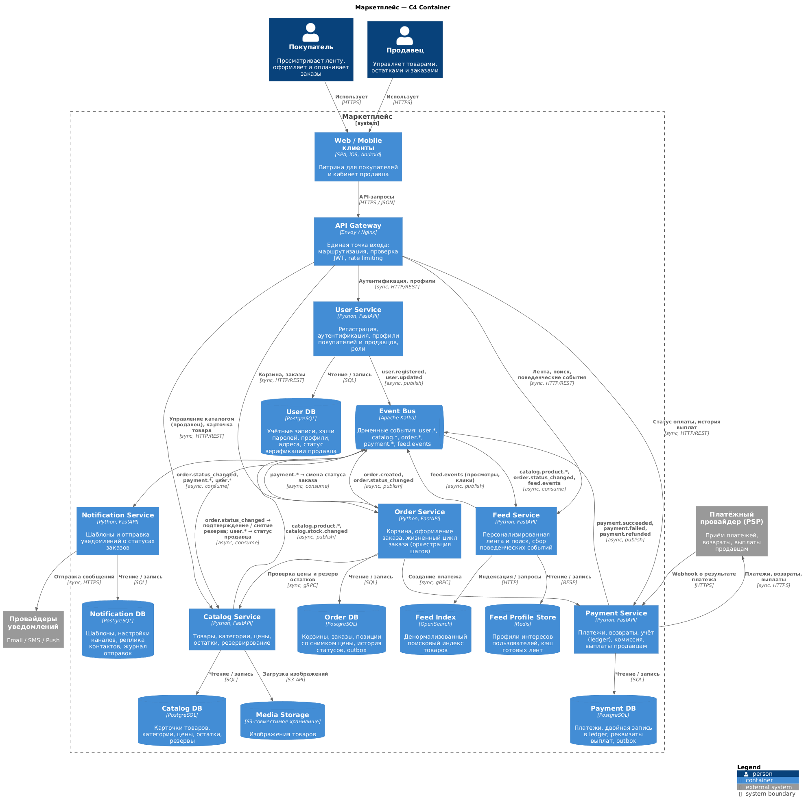
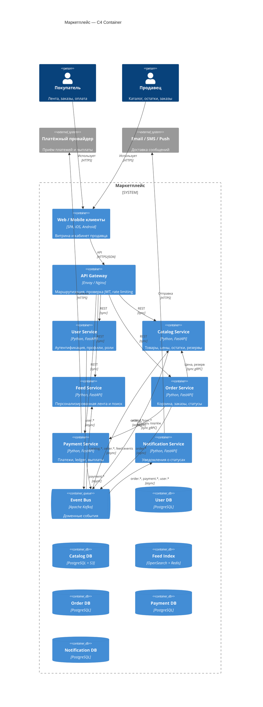
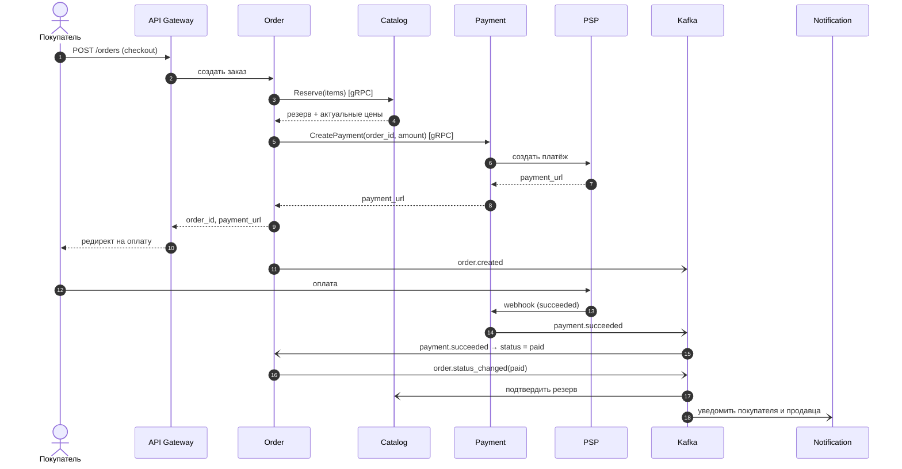

# Маркетплейс — архитектурное проектирование

Архитектура маркетплейса: продавцы размещают товары, покупатели оформляют и оплачивают заказы.
В репозитории есть C4 Container диаграмма, описание доменов, данных и взаимодействий, сравнение вариантов декомпозиции и один сервис (`catalog-service`), который поднимается в Docker и отвечает `200 OK` на `/health`.

Бизнес-логики здесь нет, так требует задание.

---

## 1. Быстрый старт

### Требования

- Docker Engine 20.10+ с плагином Docker Compose v2 (`docker compose`).

### Запуск через docker compose

```bash
docker compose up --build -d
curl -i http://localhost:8000/health
```

Ожидаемый ответ:

```
HTTP/1.1 200 OK
content-type: application/json

{"status":"ok","service":"catalog-service","version":"0.1.0"}
```

Статус встроенного Docker HEALTHCHECK:

```bash
docker inspect --format '{{.State.Health.Status}}' catalog-service   # healthy
```

Остановка:

```bash
docker compose down
```

### Запуск без compose

```bash
docker build -t marketplace/catalog-service:0.1.0 services/catalog-service
docker run --rm -p 8000:8000 marketplace/catalog-service:0.1.0
```

### Локальный запуск без Docker

```bash
cd services/catalog-service
python3 -m venv .venv && source .venv/bin/activate
pip install -r requirements.txt
uvicorn app.main:app --port 8000
```

### Внешние зависимости сервиса

| Зависимость | Версия | Назначение |
|---|---|---|
| `fastapi` | 0.115.6 | HTTP-фреймворк |
| `uvicorn` | 0.34.0 | ASGI-сервер |
| `python:3.12-slim` | — | Базовый Docker-образ |

---

## 2. Структура репозитория

```
.
├── README.md                     # архитектура, решения, инструкция запуска
├── docker-compose.yml            # запуск catalog-service
├── docs/
│   ├── c4-container.puml         # C4 Container диаграмма (C4-PlantUML)
│   └── c4-container.png          # отрисованная диаграмма
└── services/
    └── catalog-service/
        ├── Dockerfile
        ├── requirements.txt
        └── app/
            └── main.py           # GET /health
```

---

## 3. C4 Container диаграмма

Основная версия диаграммы лежит в [`docs/c4-container.puml`](docs/c4-container.puml) (нотация [C4-PlantUML](https://github.com/plantuml-stdlib/C4-PlantUML)), готовая картинка в [`docs/c4-container.png`](docs/c4-container.png).



Отрисовать её можно на [plantuml.com](https://www.plantuml.com/plantuml), в плагине PlantUML для IDE или командой `docker run --rm -v "$PWD/docs:/data" plantuml/plantuml /data/c4-container.puml`.

Ниже та же диаграмма в Mermaid, GitHub отрисует её прямо на странице. Связи с базами данных не показаны: у каждого сервиса своя БД, полный список хранилищ есть в разделе 6.



---

## 4. Домены и зоны ответственности

| # | Домен | Тип | За что отвечает |
|---|---|---|---|
| 1 | **Identity & Access** | Supporting | Регистрация, аутентификация, выпуск и обновление токенов (JWT), роли (`buyer`, `seller`, `admin`). |
| 2 | **User Profile** | Supporting | Профиль покупателя (контакты, адреса доставки), профиль продавца (юр. данные, статус верификации). |
| 3 | **Catalog** | Core | Карточки товаров, категории и атрибуты, цены, медиа, публикация и снятие с продажи. |
| 4 | **Inventory** | Core | Складские остатки продавца, резервирование под заказ, подтверждение и снятие резерва. |
| 5 | **Feed & Search** | Core | Сбор поведенческих событий (просмотры, клики, покупки), профиль интересов, ранжирование ленты, полнотекстовый поиск. |
| 6 | **Ordering** | Core | Корзина, оформление заказа, снимок цены на момент заказа, машина состояний заказа (`created → awaiting_payment → paid → shipped → delivered` / `cancelled`). |
| 7 | **Payments & Billing** | Core | Создание платежа во внешнем PSP, обработка webhook, возвраты, учёт по двойной записи (ledger), удержание комиссии площадки, выплаты продавцам. |
| 8 | **Notifications** | Generic | Шаблоны сообщений, выбор канала (email / SMS / push), пользовательские настройки подписок, журнал доставки. |

**Персонализация (сколько её и как она устроена).** Первая версия работает без ML-моделей:

1. **Кандидаты.** Из OpenSearch берутся опубликованные товары, которые есть в наличии, из категорий, с которыми пользователь недавно взаимодействовал, плюс общий популярный пул.
2. **Ранжирование.** Скор считается как взвешенная сумма трёх составляющих: совпадение с профилем интересов (веса категорий и брендов по просмотрам и покупкам с затуханием по времени), популярность товара за скользящее окно и свежесть. Веса задаются конфигурацией.
3. **Холодный старт.** Для анонимных и новых пользователей лента строится по популярности.
4. **Профиль интересов** пересчитывается асинхронно из потока событий и хранится в Redis.

Следующие шаги (за рамками задания): коллаборативная фильтрация, ML-ранжирование, A/B-тесты. Их можно добавить внутри Feed Service, и контракты с другими сервисами при этом не меняются.

---

## 5. Распределение доменов по сервисам

| Сервис | Домены | Почему они вместе / отдельно |
|---|---|---|
| **API Gateway** | — (инфраструктура) | Бизнес-логики нет. Один вход для клиентов: TLS, проверка JWT по публичному ключу User Service, rate limiting, маршрутизация. |
| **User Service** | Identity & Access, User Profile | Учётная запись и профиль описывают одну сущность и меняются вместе. Если разнести их по сервисам, при регистрации понадобится распределённая транзакция, а пользы от этого не будет. |
| **Catalog Service** | Catalog, Inventory | Резерв остатков нужно проверять в одной ACID-транзакции с актуальной ценой и статусом публикации. Если вынести Inventory отдельно, проверка «товар опубликован и есть в наличии» станет распределённой. |
| **Feed Service** | Feed & Search | Нагрузка в основном на чтение, хранилища специализированные (поисковый индекс, кэш), меняется сервис часто (эксперименты с ранжированием). Масштабируется независимо от транзакционного контура. Его отказ не должен мешать оформлению заказа. |
| **Order Service** | Ordering | Здесь проходят все шаги оформления: резерв, платёж, смена статусов. Корзина живёт рядом с заказом, потому что при checkout корзина превращается в заказ. |
| **Payment Service** | Payments & Billing | Финансовые данные требуют отдельного контура: строгий аудит, неизменяемый ledger, ограниченный доступ, отдельный цикл релизов. Платёж и учёт по нему держатся вместе, иначе пришлось бы сверять две системы между собой. |
| **Notification Service** | Notifications | Работает полностью асинхронно, зависит от внешних провайдеров и даёт всплески нагрузки. Если провайдер отказал, на заказы и платежи это не влияет. |

Правило разбиения: **один bounded context = один сервис**. Два контекста объединяются в один сервис, только если им нужна общая транзакционная согласованность (Catalog + Inventory, Identity + Profile).

---

## 6. Владение данными

**Правило: у каждого сервиса своё хранилище, и никто другой не обращается к нему напрямую.** Разделяемых баз данных нет. Чужие данные сервис получает только через API владельца или через его события. Если сервис хранит локальную копию чужих данных (read-model), он не является их владельцем и не меняет их.

| Сервис | Хранилище | Владеет данными | Read-model (копии чужих данных, только чтение) |
|---|---|---|---|
| User Service | User DB (PostgreSQL) | учётные записи, хэши паролей, refresh-токены, роли, профили покупателей, адреса, профили продавцов, статус верификации | — |
| Catalog Service | Catalog DB (PostgreSQL), Media (S3) | товары, категории, атрибуты, цены, изображения, остатки, резервы под заказ | `seller_id → статус продавца` (из `user.*`) |
| Feed Service | OpenSearch, Redis | поисковый индекс, профили интересов пользователей, сырые поведенческие события, кэш лент | денормализованные карточки товаров (из `catalog.*`), факты покупок (из `order.*`) |
| Order Service | Order DB (PostgreSQL) | корзины, заказы, позиции заказа со **снимком** цены и названия, история статусов, outbox | — |
| Payment Service | Payment DB (PostgreSQL) | платежи, возвраты, проводки ledger (двойная запись), начисленные комиссии, выплаты, реквизиты выплат продавцов, outbox | — |
| Notification Service | Notification DB (PostgreSQL) | шаблоны, настройки подписок пользователя, журнал отправок и статусы доставки | контакты пользователя: email, телефон, push-токен (из `user.*`) |

Номера карт хранит только PSP. Payment Service работает с токенами провайдера, полные данные карт в маркетплейс не попадают.

---

## 7. Взаимодействия сервисов

### 7.1. Синхронные взаимодействия

| Откуда | Куда | Протокол | Зачем | Почему синхронно |
|---|---|---|---|---|
| Клиенты | API Gateway | HTTPS / REST | все пользовательские запросы | пользователь ждёт ответа |
| API Gateway | User / Catalog / Feed / Order / Payment | HTTP / REST | маршрутизация запросов | пользователь ждёт ответа |
| Order | Catalog | gRPC | получить актуальную цену и зарезервировать остатки при checkout | без резерва нельзя создать заказ, а пользователь должен сразу узнать, если товара нет |
| Order | Payment | gRPC | создать платёж и получить ссылку на оплату у PSP | ссылку на оплату нужно сразу вернуть клиенту |
| Payment | PSP | HTTPS | создание платежа, возврат, выплата | API внешнего провайдера синхронное |
| PSP | Payment | HTTPS webhook | результат платежа | так устроен PSP; обработчик идемпотентен по `payment_id` |
| Notification | Email / SMS / Push | HTTPS | доставка сообщений | API провайдеров; отправка идёт из асинхронного consumer, поэтому для бизнес-потока она не блокирующая |

### 7.2. Асинхронные взаимодействия (Kafka)

| Издатель | Топик / событие | Подписчики | Реакция |
|---|---|---|---|
| User | `user.registered`, `user.updated` | Notification, Catalog | Notification: приветственное письмо, обновление копии контактов. Catalog: обновление статуса продавца. |
| Catalog | `catalog.product.published / updated / unpublished`, `catalog.stock.changed` | Feed | переиндексация товара, исключение из ленты товаров без остатка |
| Feed (приём от Gateway) | `feed.events` (view, click, add_to_cart) | Feed | пересчёт профиля интересов |
| Order | `order.created`, `order.status_changed` | Catalog, Feed, Notification | Catalog: подтверждение резерва (`paid`) или его снятие (`cancelled`). Feed: учёт покупки. Notification: сообщение покупателю и продавцу. |
| Payment | `payment.succeeded`, `payment.failed`, `payment.refunded` | Order, Notification | Order: переход в `paid` или `cancelled`. Notification: квитанция или сообщение об ошибке. |

Гарантии: события публикуются через **transactional outbox** (запись в БД и событие в outbox делаются одной транзакцией), доставка **at-least-once**, consumers **идемпотентны** (дедупликация по `event_id`). Ключ партиции равен ID агрегата (`order_id`, `product_id`), поэтому события одного агрегата обрабатываются по порядку.

### 7.3. Основной сценарий: оформление и оплата заказа (сага с хореографией)



Компенсации: если платёж не прошёл или резерв истёк по таймауту, Order переводит заказ в `cancelled` и публикует `order.status_changed(cancelled)`, после чего Catalog снимает резерв. Если Payment недоступен в момент checkout, Order сразу снимает резерв синхронным вызовом `Release` и возвращает клиенту ошибку.

---

## 8. Альтернативные варианты декомпозиции

### Вариант A. Модульный монолит

Один деплоймент и одна кодовая база, внутри модули по тем же доменам: `users`, `catalog`, `feed`, `orders`, `payments`, `notifications`. Одна СУБД PostgreSQL, у каждого модуля своя схема. Модули общаются через внутренние интерфейсы и in-process шину событий. Поиск по-прежнему вынесен в OpenSearch.

### Вариант B. Микросервисы по bounded context (выбран)

Шесть доменных сервисов и API Gateway, описанные выше. У каждого сервиса своя БД. Синхронно сервисы вызывают друг друга только там, где пользователь ждёт ответа; всё остальное идёт через события в Kafka.

### Вариант C. Крупные сервисы по контурам нагрузки и критичности

Три сервиса:

1. **Commerce Core**: пользователи, каталог, остатки и заказы, одна БД.
2. **Payments**: платежи и учёт, отдельная БД.
3. **Engagement**: лента, поиск и уведомления; OpenSearch, Redis и своя БД.

Транзакционное ядро здесь монолитное, отдельно вынесены только финансы и контур, где важнее всего производительность чтения.

---

## 9. Trade-off'ы вариантов

### Вариант A. Модульный монолит

| Плюсы | Минусы |
|---|---|
| Резерв остатков, создание заказа и смена статуса делаются одной ACID-транзакцией, сага и компенсации не нужны. | Масштабировать можно только всё приложение целиком. Ради нагрузки на ленту приходится масштабировать и платежи. |
| Минимум инфраструктуры: один деплой, одна БД, брокер не обязателен. | Общий процесс: утечка памяти или тяжёлый запрос ленты могут уронить checkout и обработку webhook от PSP. |
| Межмодульные вызовы идут без сетевых задержек и сетевых отказов. | Финансовые данные лежат в одной БД с остальными, поэтому изолировать доступ и аудит сложнее: границу держит только дисциплина схем. |
| Рефакторинг границ модулей дешёвый, всё в одном репозитории. | Все релизы общие: изменение ранжирования ленты требует релиза вместе с платёжным кодом. |
| Удобно, когда команда небольшая, а домены ещё меняются. | Границы модулей со временем размываются (прямые JOIN между схемами), и потом выделить сервисы становится дорого. |

### Вариант B. Микросервисы по bounded context

| Плюсы | Минусы |
|---|---|
| Сервисы масштабируются независимо: Feed по чтению, Notification по всплескам, Order и Payment по транзакциям. | Распределённые транзакции: checkout требует саги, компенсаций, outbox и идемпотентности, а это сложнее, чем одна транзакция. |
| Отказы изолированы: если упал Feed или Notification, заказы всё равно оформляются и оплачиваются. | Согласованность итоговая: Feed и Notification видят изменения с задержкой. |
| Финансовый контур отделён: своя БД, свои доступы, свой цикл релизов и аудита. | Дорогая эксплуатация: 7 деплойментов, Kafka, распределённая трассировка, контрактные тесты. |
| Каждому домену подходящее хранилище: PostgreSQL для транзакций, OpenSearch и Redis для ленты. | Сетевые задержки и отказы на синхронном пути checkout (Order → Catalog → Payment): нужны таймауты, ретраи, circuit breaker. |
| Команды работают и релизятся независимо, контракты зафиксированы явно. | Ошибку в границах исправить дорого: перенос данных между сервисами означает миграцию. |

### Вариант C. Крупные сервисы по контурам

| Плюсы | Минусы |
|---|---|
| Резерв и создание заказа остаются локальной ACID-транзакцией внутри Commerce Core. | Commerce Core вырастает в мини-монолит с тремя доменами: общий релизный цикл и риск размытия границ. |
| Финансы изолированы так же, как в варианте B. | Лента и уведомления живут в одном сервисе, хотя у них разные профили нагрузки и отказов: всплеск рассылок бьёт по латентности ленты. |
| Инфраструктуры и сетевых вызовов меньше, чем в B: 3 сервиса вместо 6. | Каталог (нагрузка от продавцов, загрузка медиа) масштабируется только вместе с заказами и пользователями. |
| Хороший промежуточный шаг между A и B. | Командам, которые делят Commerce Core, сложно владеть им независимо. |

### Сводное сравнение

| Критерий | A. Монолит | B. Микросервисы | C. Контуры |
|---|---|---|---|
| Согласованность checkout | ACID | Сага (итоговая) | ACID в ядре, сага с Payments |
| Независимое масштабирование | нет | полное | частичное |
| Изоляция отказов ленты и уведомлений от заказов | нет | да | частично (лента и уведомления зависят друг от друга) |
| Изоляция финансовых данных | слабая | сильная | сильная |
| Стоимость эксплуатации | низкая | высокая | средняя |
| Независимые релизы команд | нет | да | частично |

---

## 10. Финальный выбор и обоснование

**Выбран вариант B: микросервисы по bounded context.**

Обоснование опирается на требования кейса:

1. **У требований разные профили нагрузки.** Персонализированная лента нагружена в основном чтением и требует специализированных хранилищ (поисковый индекс, кэш профилей). Оформление заказов и платежи нагружены транзакционной записью и требуют строгой согласованности. Уведомления асинхронные и зависят от внешних провайдеров. В варианте A эти три профиля делят один процесс и одну БД. В варианте C лента и уведомления оказываются в одном сервисе.
2. **Ошибки в платежах обходятся дорого.** Учёт платежей требует неизменяемого ledger, аудита и ограниченного доступа. Отдельный Payment Service со своей БД даёт эту границу физически, а не только на уровне соглашений.
3. **Отказ второстепенных функций не должен останавливать продажи.** Если Feed или Notification недоступны, покупатель всё равно может оформить и оплатить заказ. В B это обеспечивает архитектура: эти сервисы получают события асинхронно и не стоят на синхронном пути checkout.
4. **Перечень функций в кейсе почти совпадает с bounded context'ами.** Шесть требуемых возможностей ложатся на шесть сервисов. Объединения сделаны только там, где нужна общая транзакция (Catalog + Inventory, Identity + Profile). Поэтому сервисов ровно столько, сколько нужно, без лишнего дробления (отдельные Cart, Inventory, Auth не выделены).
5. **Главный минус B, распределённую согласованность checkout, можно контролировать.** На синхронном пути всего два межсервисных вызова (резерв и создание платежа), остальное сделано сагой с хореографией, outbox и идемпотентными consumers. Это известные шаблоны с понятной стоимостью.

**Допущения, при которых выбор верен:**

- над продуктом работает больше одной команды, и каждая отвечает за свои домены;
- нагрузка на ленту заметно выше нагрузки на оформление заказов (типичная воронка e-commerce; конкретных цифр в кейсе нет);
- есть платформенная поддержка: контейнерная оркестрация, Kafka, централизованные логи и трассировка.

**Когда выбор стоит пересмотреть:** если команда одна и продукт на стадии MVP, разумнее начать с варианта A и сразу соблюдать границы модулей и владение схемами из раздела 6. Тогда переход к B сведётся к выносу модулей в отдельные сервисы без перепроектирования доменов.

---

## 11. Реализованный сервис

`catalog-service`: каркас Catalog Service на Python 3.12 + FastAPI.

| Endpoint | Метод | Ответ |
|---|---|---|
| `/health` | GET | `200 OK`, `{"status":"ok","service":"catalog-service","version":"0.1.0"}` |
| `/docs` | GET | Swagger UI (генерируется FastAPI) |

В образе настроен `HEALTHCHECK`, который раз в 10 с опрашивает `/health`. Процесс запускается от непривилегированного пользователя `appuser`.
