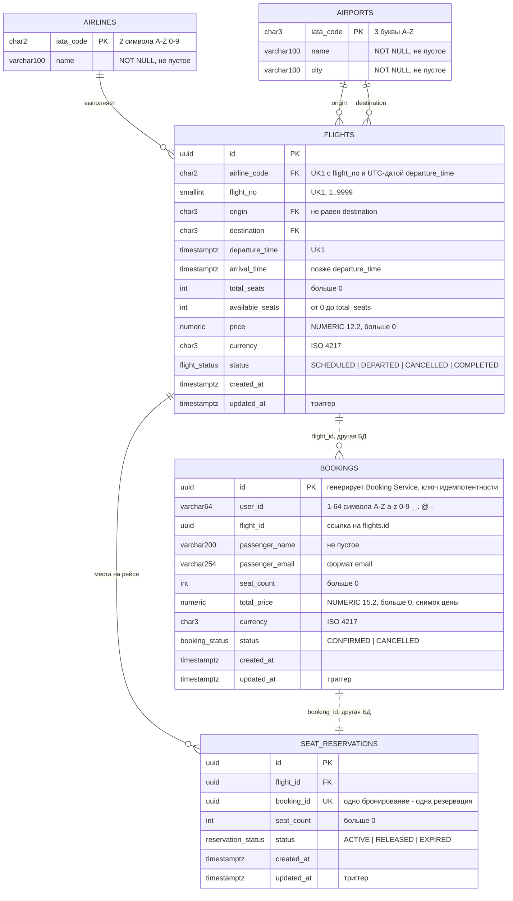

# ER-диаграмма

Две независимые базы данных: `flights` (Flight Service) и `bookings` (Booking Service).
Связи между базами логические, без внешних ключей. Они показаны пунктиром.
DDL: [`flight-service/migrations/V1__init_schema.sql`](../flight-service/migrations/V1__init_schema.sql),
[`booking-service/migrations/V1__init_schema.sql`](../booking-service/migrations/V1__init_schema.sql).

## Почему это 3NF

| Отношение | Ключи | Обоснование |
|---|---|---|
| `airlines` | `iata_code` | Одно неключевое поле `name`, оно зависит от ключа. |
| `airports` | `iata_code` | `name`, `city` зависят только от кода аэропорта. Город — атрибут аэропорта, отдельной сущностью в задаче не выступает. |
| `flights` | `id`; `(airline_code, flight_no, UTC-дата departure_time)` | Названия авиакомпании и аэропортов вынесены в справочники, в `flights` только коды (FK). Номер рейса хранится как `airline_code` + `flight_no`, а не строкой `SU1234`. Если хранить строку рядом с `airline_code`, получилась бы зависимость `flight_number → airline_code` от части ключа `(flight_number, дата)`, а это нарушение 2NF. Строка `SU1234` собирается при чтении. |
| `seat_reservations` | `id`; `booking_id` | Все атрибуты описывают резервацию. Рейс задан только через `flight_id`. |
| `bookings` | `id` | Цена места не хранится: `total_price / seat_count` даёт её, и пара (`unit_price`, `total_price`) была бы транзитивной зависимостью. `total_price` — снимок на момент бронирования, а не производная от текущей цены рейса. Данные рейса не копируются, только `flight_id`. |

`flights.available_seats` по смыслу равно `total_seats − Σ seat_count` активных резерваций. Задание требует хранить это поле явно. Функциональной зависимости внутри одного отношения оно не создаёт: это агрегат по другой таблице, поэтому 3NF формально не нарушена. Согласованность обеспечивается транзакцией. `available_seats` меняется только вместе со строкой `seat_reservations` под `SELECT … FOR UPDATE` строки рейса.

## Ограничения целостности

| Ограничение | Где |
|---|---|
| `available_seats >= 0`, `available_seats <= total_seats`, `total_seats > 0` | `flights` CHECK |
| `price > 0`, `total_price > 0`, `seat_count > 0` | CHECK |
| `origin <> destination`, `arrival_time > departure_time` | `flights` CHECK |
| IATA-коды, ISO 4217, формат email и `user_id` | CHECK с регулярными выражениями |
| Номер рейса уникален в пределах даты вылета (UTC) | `UNIQUE INDEX uq_flights_number_departure_date` по выражению |
| Одна резервация на бронирование | `UNIQUE (seat_reservations.booking_id)` |
| Статусы только из перечня | типы `ENUM` PostgreSQL |
| Рейс ссылается на существующие авиакомпанию и аэропорты, резервация — на рейс | `FOREIGN KEY` |
