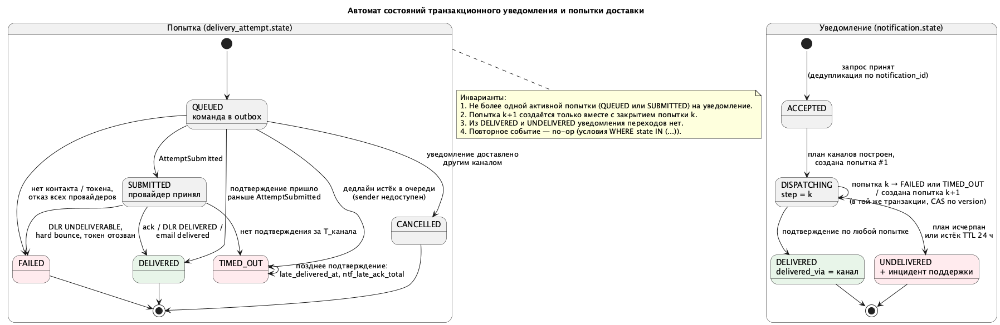
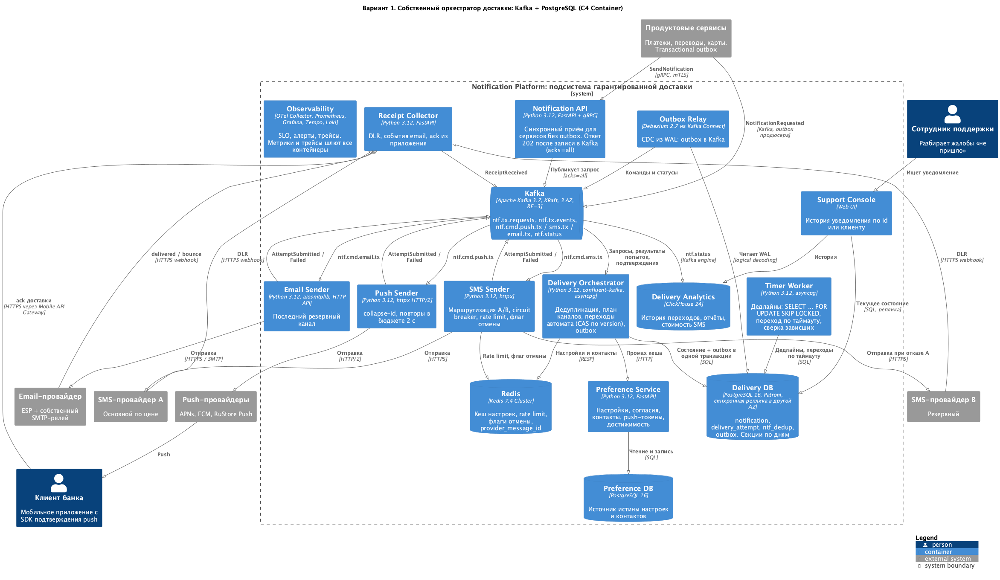
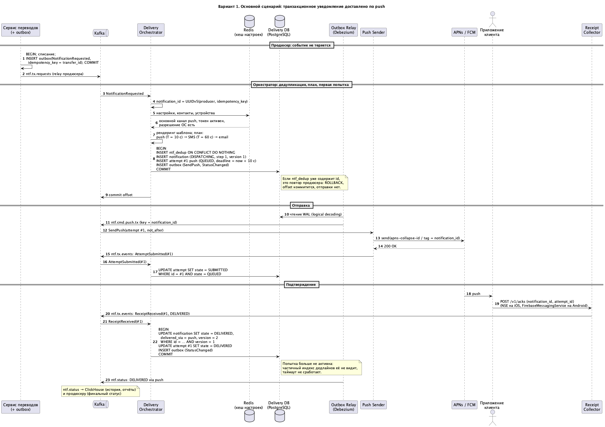
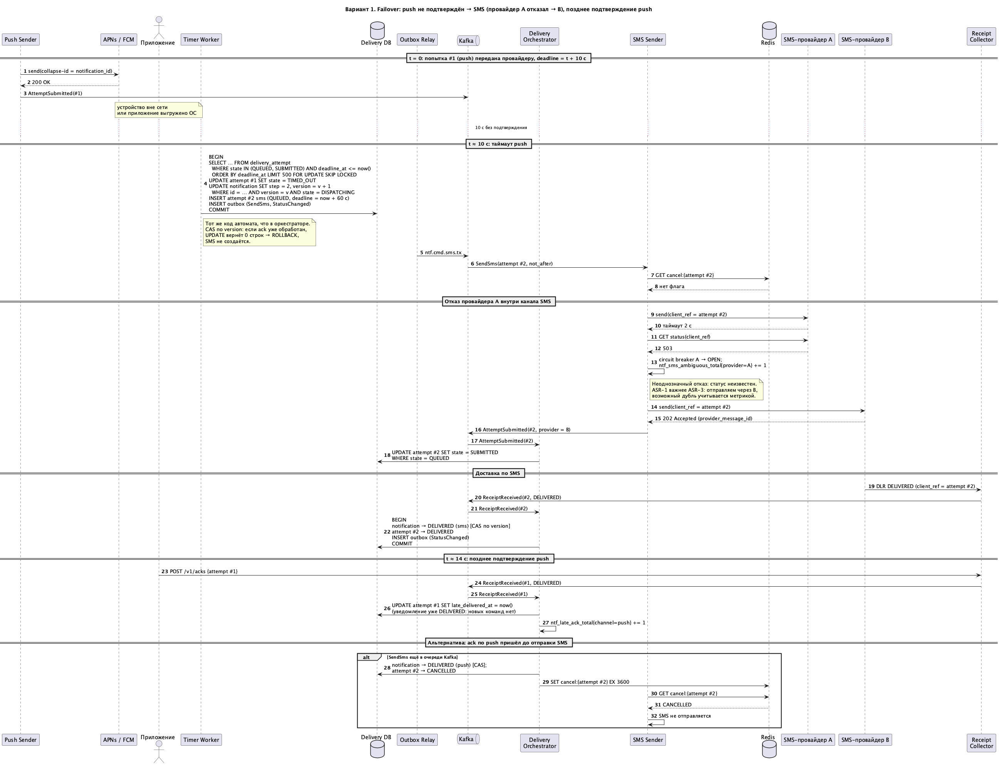
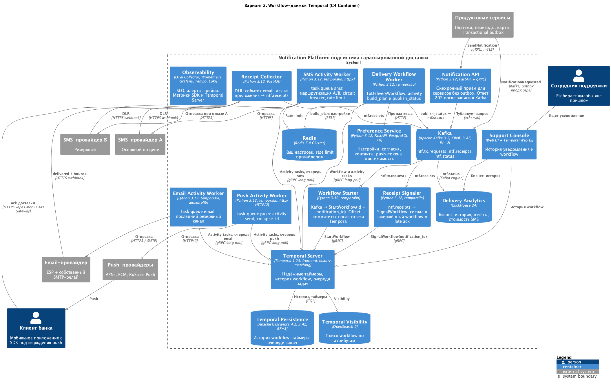
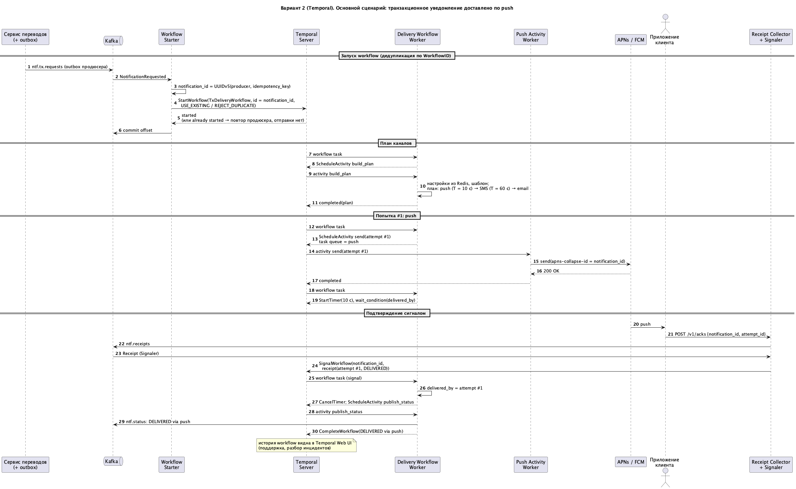
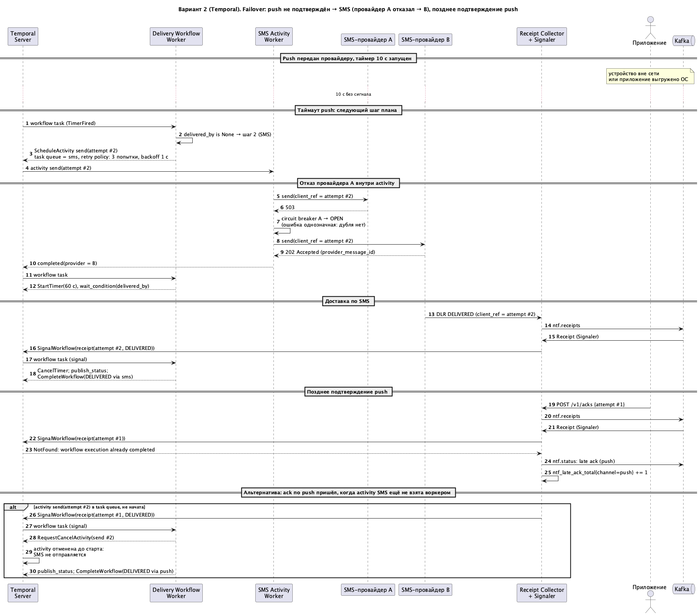

# RFC: Гарантированная доставка критичных уведомлений с кросс-канальным failover

| Метаданные | Значение |
|------------|----------|
| **Статус** | DESIGN |
| **Автор(ы)** | Карам Сулейманов |
| **Ответственный** | Карам Сулейманов |
| **Бизнес-заказчик** | Владелец продукта «Уведомления» (роль; учебный кейс, конкретного лица нет) |
| **Ревьюеры** | Архитектурный комитет, преподаватель курса — на ревью, дата не назначена |
| **Дата создания** | 2026-11-18 |
| **Дата обновления** | 2026-11-18 |

Оформлено по [шаблону курса](rfc-template.md). Отправная точка — требования и ASR всей Notification Platform из [README](../README.md) (задания 1–3). В этом документе требования подсистемы обозначены `FR1`, `NFR1`, …; требования платформы из README — `FR-1`, `NFR-1`, `ASR-1`, …

---

## Оглавление

1. [Контекст](#контекст)
2. [Продуктовый анализ](#продуктовый-анализ)
3. [Пользовательские сценарии](#пользовательские-сценарии)
4. [Статистика](#статистика)
5. [Требования](#требования)
6. [Варианты решения](#варианты-решения)
7. [Сравнительный анализ](#сравнительный-анализ)
8. [Выводы](#выводы)
9. [Связанные задачи](#связанные-задачи)
10. [Приложения](#приложения)

---

## Контекст

Транзакционное уведомление (списание, перевод, вход с нового устройства), принятое платформой, должно быть доставлено клиенту хотя бы по одному каналу или явно помечено как недоставленное с инцидентом для поддержки. Терять его молча нельзя.

Сейчас каждая продуктовая команда отправляет уведомления сама. Для критичных сообщений это даёт три проблемы:

1. **Нет гарантии.** Отправка — синхронный вызов провайдера без надёжного состояния. Сбой SMS-шлюза или рестарт сервиса после списания означает, что клиент ничего не узнает, и никто этого не заметит.
2. **Нет failover.** Если push не дошёл (приложение удалено, устройство вне сети), другой канал не пробуется. Либо, наоборот, команда шлёт SMS «на всякий случай» всем, и это дорого.
3. **Дубли и нет наблюдаемости.** Повторы на стороне продюсеров не дедуплицируются. На жалобу «не пришло» поддержка ответить не может.

### Ключевые вопросы

- **Какую проблему мы решаем?** Принятое транзакционное уведомление теряется при сбоях. Резервного канала нет. При повторах приходят дубли. Нельзя узнать, что и когда было доставлено.
- **Почему это важно сейчас?** Платформа уведомлений централизует все отправки (README, FR-1). Если в неё не заложить гарантию доставки сразу, команды не перенесут на неё критичные сценарии и продолжат отправлять сами. Кроме того, о мошеннических списаниях клиент узнаёт именно из этих уведомлений: каждое потерянное уведомление — это задержка реакции на мошенничество.
- **Кто затронут этим изменением?**
  - клиенты банка — получатели;
  - продуктовые команды платежей, переводов и карт — продюсеры, которые переходят на единый контракт и outbox;
  - мобильные команды — SDK подтверждения push;
  - поддержка — история уведомлений;
  - SRE — эксплуатация;
  - финансы — расходы на SMS.

### Цели и не-цели

Цели:

- G1. Каждое принятое транзакционное уведомление приходит в конечный статус: `DELIVERED` (с указанием канала) или `UNDELIVERED` (с инцидентом).
- G2. Автоматический failover между каналами и между провайдерами одного канала.
- G3. Нет дублей, видимых клиенту, при повторах продюсеров и внутренних повторах. При failover дубли ограничены и измеряются.
- G4. Минимум платных SMS при соблюдении SLO задержки.
- G5. Полная наблюдаемость: метрики, трейсы и история каждого уведомления для поддержки.

Не-цели:

- Одноразовые коды (OTP, 3-D Secure). У них другие требования (TTL кода, защита от перехвата) и отдельный сервис.
- Сервисные и маркетинговые уведомления. Они идут по отдельным конвейерам платформы без кросс-канального failover. Подсистема только изолирует себя от их нагрузки.
- Сегментация, кампании, шаблонизатор и UI настроек. Это другие части платформы. Подсистема использует их через API.
- Катастрофоустойчивость при потере целого региона с RPO = 0 (см. [ограничение K8](#ключевые-компромиссы-и-ограничения)).

### Кратко о предлагаемом решении

- **Последовательный failover по плану каналов.** По умолчанию порядок такой: push → SMS → email. План учитывает основной канал, выбранный клиентом, и достижимость устройства. Следующий канал запускается, только если текущий не подтвердил доставку за таймаут канала. Так SMS отправляются только там, где push не сработал.
- **Подтверждённая доставка.** Каналы считаются доставившими сообщение только по подтверждению: ack из приложения, DLR, событие `delivered` у email. Принятие сообщения провайдером доставкой не считается.
- **Надёжный автомат состояний.** Состояние уведомления и попыток хранится надёжно. Переходы атомарные и условные (compare-and-set по версии): в гонке «подтверждение против таймаута» побеждает ровно одно событие.
- **Повторы без дублей.** Передача at-least-once на каждом шаге в сочетании с идемпотентностью: детерминированный `notification_id`, ключ попытки у провайдера, collapse-id на устройстве.

Рассмотрены два варианта реализации оркестратора:

- **Вариант 1** — собственный автомат состояний на Kafka + PostgreSQL;
- **Вариант 2** — workflow-движок Temporal.

Рекомендуется вариант 1 (см. [Выводы](#выводы)).

---

## Продуктовый анализ

### Вклад в бизнес-цели

| Бизнес-цель платформы | Вклад подсистемы | Продуктовая метрика |
|---|---|---|
| Гарантированная доставка критичных уведомлений | failover между каналами и провайдерами; конечный статус у каждого уведомления; инцидент при недоставке | доля транзакционных, доставленных за ≤ 60 с и за ≤ 15 мин; число `UNDELIVERED` в сутки |
| Снижение жалоб на 30% | нет пропусков и дублей; поддержка отвечает по истории, а не эскалирует разработчикам | жалобы «не пришло» и «пришло дважды» на 1 млн транзакционных. Базового значения нет, его нужно снять до запуска (см. [Статистика](#статистика)) |
| Рост retention на 15% | косвенный: доверие к банку, своевременная реакция на мошенничество. Основной вклад дают сервисные и маркетинговые части платформы | на уровне подсистемы не измеряется |

### Характеристики каналов

| Канал | Стоимость | Задержка | Подтверждение доставки | Типичные причины отказа |
|---|---|---|---|---|
| push | нет платы за сообщение у APNs и FCM; затраты только на инфраструктуру | секунды; зависит от состояния устройства и ОС | только через ack из приложения (наш SDK) | нет токена, токен отозван, уведомления выключены в ОС, устройство вне сети |
| SMS | платный, цена за сегмент по договору; кириллица — 70 символов в одном сегменте | секунды; зависит от оператора | DLR от оператора через провайдера | недоступность провайдера, задержки DLR, телефон выключен |
| email | низкая | от секунд до минут | событие провайдера `delivered` (письмо принято сервером получателя), не факт прочтения | bounce, спам-фильтры, нет адреса |

Конкретных цен у нас нет. В расчётах стоимость SMS обозначена параметром `C_sms` (см. [Попытки по каналам и стоимость](#попытки-по-каналам-и-стоимость)).

### Продуктовые решения

1. **Транзакционные уведомления отключить нельзя.** Ни тип целиком, ни резервные каналы. Клиент выбирает только основной канал: push (по умолчанию) или SMS. Причина — безопасность: клиент должен узнать о движении средств, чтобы вовремя заметить мошенничество.
2. **Push — основной канал по умолчанию.** Он бесплатный за сообщение и быстрый. SMS — резерв, email — последний резерв.
3. **«SMS всем»** (так сейчас работают часть команд) отклонено. При сопоставимой гарантии это до 6 млн SMS в сутки вместо около 1,7 млн, и клиенты с работающим push получают дубли.
4. **«Только push»** отклонено. Около 25% транзакционных уведомлений не могут быть доставлены по push (оценка [A4]), и гарантии нет.
5. Тихие часы и лимиты частоты к транзакционным не применяются.

---

## Пользовательские сценарии

| Приоритет | Тип сценария | Действующее лицо | Сценарий |
|-----------|--------------|------------------|----------|
| MUST HAVE | Основной | Клиент | Клиент оплатил покупку картой. Через несколько секунд на телефон приходит push о списании |
| MUST HAVE | Failover канала | Клиент | Телефон вне сети для push (выгружено приложение, нет интернета). Push не подтверждён за таймаут, и клиент получает SMS о списании |
| MUST HAVE | Failover провайдера | Система | Основной SMS-провайдер недоступен. SMS уходит через резервного провайдера без участия людей и без потери уведомления |
| MUST HAVE | Повтор продюсера | Сервис переводов | Сервис повторно отправил запрос на уведомление после таймаута. Клиент получает одно уведомление |
| MUST HAVE | Настройки | Клиент | Клиент выбирает SMS основным каналом для транзакционных. Попытка отключить транзакционные уведомления в UI недоступна, рядом показано объяснение |
| MUST HAVE | Недоставка | Сотрудник поддержки | У клиента нет действующих контактов или все каналы отказали. Уведомление получает статус `UNDELIVERED`, создаётся инцидент, продюсер получает финальный статус |
| MUST HAVE | Разбор жалобы | Сотрудник поддержки | Клиент пишет: «не пришло SMS о списании». Поддержка находит уведомление по клиенту и времени и видит план, попытки, провайдеров и причины отказов |
| SHOULD HAVE | Позднее подтверждение | Клиент | Подтверждение push пришло после решения о failover. Если SMS ещё не отправлен, он отменяется. Если отправлен, клиент получает не больше одного дубля, и это учитывается в метрике |
| SHOULD HAVE | Контроль стоимости | Владелец платформы, финансы | Ежедневный отчёт: доля транзакционных по SMS и число сегментов по командам-продюсерам |
| SHOULD HAVE | Мониторинг | Дежурный SRE | Алерт о сгорании бюджета ошибок SLO, росте failover, открытом circuit breaker провайдера |
| COULD HAVE | Адаптация | Система | Таймаут ожидания push подстраивается под фактическое распределение задержки ack по ОС |
| COULD HAVE | Безопасность | Клиент | Вход с нового устройства: ускоренный failover (короче таймаут push), потому что важна скорость реакции |

---

## Статистика

### Масштаб (из условия)

| Показатель | Значение |
|---|---|
| MAU | 10 млн |
| DAU | 3 млн |
| Пиковое число одновременных пользователей | 300 000 |
| Транзакционных уведомлений на DAU в сутки | 2 |
| Сервисных на DAU в сутки | 3 |
| Маркетинговых на DAU в сутки | 5 |

### Суточные объёмы (производные, сутки = 86 400 с)

| Тип | Расчёт | В сутки | Среднее, уведомлений/с |
|---|---|---|---|
| Транзакционные | 3 млн × 2 | 6 000 000 | 69,4 |
| Сервисные | 3 млн × 3 | 9 000 000 | 104,2 |
| Маркетинговые | 3 млн × 5 | 15 000 000 | 173,6 |
| **Итого** | | **30 000 000** | **347,2** |

Пиковые значения и производные нагрузки — в разделе [Расчёт нагрузок](#расчёт-нагрузок).

### Статистика, которой нет и которую нужно собрать

Перечисленных ниже данных у нас нет. В расчётах вместо них использованы помеченные допущения [A*]. Выдумывать эти данные нельзя: их нужно снять до финального решения о параметрах.

| Что нужно | Зачем | Источник |
|---|---|---|
| Распределение задержки ack push по ОС и доля push без подтверждения | таймаут push, доля SMS ([A5]) | пилот SDK подтверждений (этап 1) |
| Доля клиентов без push-токена, с запретом уведомлений в ОС, со старой версией приложения | доля SMS-first ([A4]), ограничение K4 | мобильная аналитика |
| Поминутный профиль транзакций за год | пиковая нагрузка ([A1]–[A3]) | процессинг |
| Время DLR и доля недоставленных SMS по провайдерам | `T_sms`, доля email ([A6]) | команды, которые уже отправляют SMS; песочницы провайдеров |
| Цена SMS-сегмента по договорам (`C_sms`) | абсолютная стоимость | закупки |
| Базовое число жалоб «не пришло» и «дубль» | метрика бизнес-цели «−30% жалоб» | поддержка, CRM |

---

## Требования

### Функциональные требования

| № | Приоритет | Обозначение | Требование |
|---|-----------|-------------|------------|
| 1 | MUST HAVE | FR1 | Подсистема принимает транзакционное уведомление с ключом идемпотентности продюсера и возвращает `notification_id`. Повторный запрос с тем же ключом возвращает тот же `notification_id` и ничего не отправляет (платформа: FR-1, FR-4) |
| 2 | MUST HAVE | FR2 | Для каждого уведомления строится план каналов с учётом основного канала клиента, наличия контактов и достижимости push-устройства (FR-2, FR-3) |
| 3 | MUST HAVE | FR3 | Если попытка в текущем канале завершилась отказом или не подтверждена за таймаут канала, подсистема автоматически переходит к следующему каналу плана (FR-2) |
| 4 | MUST HAVE | FR4 | При отказе провайдера внутри канала подсистема переключается на резервного провайдера того же канала, не меняя канал (FR-2) |
| 5 | MUST HAVE | FR5 | Транзакционные уведомления нельзя отключить. Клиент выбирает основной канал (push или SMS); резервные каналы не отключаются (FR-3) |
| 6 | MUST HAVE | FR6 | Если подтверждение по каналу пришло, следующие каналы не запускаются. Если команда для следующего канала ещё не отправлена провайдеру, она отменяется (FR-4) |
| 7 | MUST HAVE | FR7 | Когда план исчерпан или истёк TTL 24 ч, уведомление получает статус `UNDELIVERED` и для поддержки создаётся инцидент. Продюсер получает финальный статус (FR-2, FR-8) |
| 8 | MUST HAVE | FR8 | По `notification_id` или по клиенту доступна история: план, попытки, провайдеры, коды ошибок, время каждого перехода (FR-8) |
| 9 | SHOULD HAVE | FR9 | Таймаут ожидания push адаптируется по фактической задержке ack. Push пропускается, если устройство заведомо недостижимо (FR-2, FR-3) |
| 10 | COULD HAVE | FR10 | Для отдельных категорий (например, «вход с нового устройства») задаются собственные таймауты и порядок каналов (FR-2) |

### Нефункциональные требования

| № | Приоритет | Обозначение | Требование |
|---|-----------|-------------|------------|
| 1 | MUST HAVE | NFR1 | Задержка от приёма до передачи провайдеру первого канала: p95 ≤ 300 мс, p99 ≤ 1 с при 1 000 уведомлений/с (NFR-1) |
| 2 | MUST HAVE | NFR2 | Сквозная задержка до подтверждённой доставки хотя бы по одному каналу: p95 ≤ 5 с, p99 ≤ 30 с; ≥ 99,9% доставлены за ≤ 15 мин (путь через email). Знаменатель — уведомления клиентов, у которых есть хотя бы один действующий контакт (NFR-2, NFR-3) |
| 3 | MUST HAVE | NFR3 | После ответа «принято» (запись в Kafka с `acks=all` или коммит outbox продюсера) потери уведомлений нет: RPO = 0 при отказе узла или AZ (NFR-3) |
| 4 | MUST HAVE | NFR4 | 100% уведомлений приходят в конечный статус за ≤ 24 ч. Сверка находит уведомления без активного дедлайна за ≤ 5 мин (NFR-3) |
| 5 | MUST HAVE | NFR5 | Дубли: 0 повторных отправок при повторе продюсера в окне 7 суток; дубли на устройстве в одном канале ≤ 0,01%; кросс-канальные поздние подтверждения ≤ 2% (NFR-6) |
| 6 | MUST HAVE | NFR6 | Переключение с отказавшего SMS-провайдера ≤ 30 с; повторы не превышают квоту провайдера (NFR-7) |
| 7 | SHOULD HAVE | NFR7 | Доля транзакционных, ушедших по SMS, ≤ 35% (расчётно около 29%). SMS-шаблоны транзакционных укладываются в 1 сегмент (NFR-9) |
| 8 | MUST HAVE | NFR8 | Наблюдаемость: событие перехода видно в истории за ≤ 60 с; SLO-алерт срабатывает за ≤ 5 мин; метрики, логи и трейсы есть в разрезе канала, провайдера и продюсера (NFR-8) |
| 9 | MUST HAVE | NFR9 | SLA приёма 99,95% в месяц (≤ 21,6 мин простоя за 30 дней); отказ одной AZ не прерывает доставку; RTO stateful-компонентов ≤ 5 мин (NFR-4) |
| 10 | MUST HAVE | NFR10 | Масштабируемость и изоляция: 1 000/с постоянно, всплески до 2 000/с длительностью до 5 мин, рост ×3 без смены архитектуры. Кампания на 1 млн получателей ухудшает NFR1 не больше чем на 10% (NFR-5) |
| 11 | MUST HAVE | NFR11 | Безопасность и ПДн: телефоны, email и тексты шифруются при хранении и передаче; в логах нет ПДн; ack принимается только от устройства клиента, которому адресовано уведомление (NFR-10) |

### Архитектурно значимые требования (ASR)

ASR платформы (README, §3) уточнены для подсистемы. Приоритет определяет, какой ASR выигрывает при конфликте.

| Приоритет | ASR | Уточнение для подсистемы | Требования |
|---|---|---|---|
| **P1** | ASR-1. Гарантированная доставка с failover | надёжное состояние и надёжные таймеры, конечный статус для 100% уведомлений, failover между каналами и провайдерами | FR3, FR4, FR7, NFR3, NFR4, NFR9 |
| **P1** | ASR-3. Отсутствие дублей | дедупликация продюсера, единственный активный канал, CAS-переходы, ключи идемпотентности у провайдеров | FR1, FR6, NFR5 |
| **P1** | ASR-2. Низкая задержка и изоляция | p99 ≤ 1 с до провайдера при 1 000/с и параллельной кампании | NFR1, NFR2, NFR10 |
| **P2** | ASR-6. Минимальная стоимость | последовательный failover, достижимость устройства, маршрутизация SMS по цене | FR2, FR9, NFR7 |
| **P2** | ASR-4. Нестабильные провайдеры | несколько провайдеров на канал, circuit breaker, bulkhead, бюджет повторов | FR4, NFR6 |
| **P2** | ASR-7. Наблюдаемость | в подсистеме приоритет повышен с P3 до P2: это явное требование задачи | FR8, NFR8 |

Правила разрешения конфликтов:

- **ASR-1 против ASR-6.** Гарантия важнее стоимости. Если подтвердить push нельзя, отправляется SMS.
- **ASR-2 против ASR-6.** Таймаут push — точка компромисса (K1). Он калибруется так, чтобы выполнялся NFR2, а не чтобы минимизировать стоимость.
- **ASR-1 против ASR-3.** Если неизвестно, отправил ли провайдер сообщение (таймаут без ответа), выбирается повторная отправка, то есть возможный дубль, а не риск недоставки. Дубль измеряется.

### Расчёт нагрузок

Расчёты дают порядок величин. Допущения помечены **[A*]**; их проверка описана в разделе [Риски, допущения и открытые вопросы](#риски-допущения-и-открытые-вопросы).

```
Транзакционные:      3 млн DAU × 2           = 6 000 000 в сутки → 69,4/с в среднем
Пик:                 6 млн × 10% / 3 600 с   = 166,7/с в пиковый час         [A1]
                     × 3 (минутный пик)      = 500/с                          [A2]
                     × 2 (особые дни)        = 1 000/с — расчётный пик        [A3]
Попыток на уведомление:  0,75 push + 0,2875 SMS + 0,00575 email ≈ 1,04        [A4–A6]
SMS в сутки:         6 млн × 0,2875          ≈ 1 725 000 → стоимость 1 725 000 × C_sms
Вариант 1 (PostgreSQL):  ≈ 11,3 записи строк, ≈ 3,1 транзакции на уведомление
                     → пик ≈ 11 300 строк/с, ≈ 3 100 транзакций/с
Вариант 1 (Kafka):   ≈ 8,2 сообщения на уведомление → пик ≈ 8 200 сообщений/с, ≈ 8 МБ/с
Вариант 2 (Temporal): ≈ 30 событий истории, ≈ 8 записей на workflow
                     → пик ≈ 30 000 событий/с, ≈ 8 000 записей/с + ≈ 3 000 visibility/с
Хранение (вариант 1): ≈ 2,1 КБ на уведомление → ≈ 12,7 ГБ в сутки → ≈ 380 ГБ за 30 суток
```

#### Пиковая нагрузка

| Шаг | Допущение | Результат |
|---|---|---|
| Пиковый час | **[A1]** в пиковый час приходится 10% суточного объёма транзакционных | 600 000 в час → 166,7/с |
| Минутные пики | **[A2]** минутный пик внутри часа в 3 раза выше среднего за час | 500/с |
| Особые дни | **[A3]** дни зарплат и распродажи дают ещё ×2 | **1 000/с — расчётный пик** |
| Всплеск | решение автора: запас на всплески до 5 мин | 2 000/с |

Проверка на правдоподобие: 1 000 уведомлений/с при 300 000 одновременных пользователей — это одно транзакционное уведомление на пользователя раз в 300 с. Для пикового дня это правдоподобно. Это проверка порядка величины, а не данные.

Параллельно идёт нагрузка, от которой подсистема изолируется. Кампания на 1 млн за 30 мин даёт 1 000 000 / 1 800 с ≈ 556/с. Сервисные на пике по тем же [A1]–[A3]: 9 млн × 0,1 / 3 600 × 3 × 2 ≈ 1 500/с.

#### Попытки по каналам и стоимость

Допущения:

- **[A4]** 25% транзакционных уведомлений сразу идут по SMS: нет активного push-токена, уведомления выключены в ОС, клиент выбрал SMS основным каналом или push давно не подтверждался.
- **[A5]** 5% уведомлений, начатых с push, не подтверждаются за `T_push` и переходят на SMS.
- **[A6]** 2% SMS не получают DLR DELIVERED за `T_sms` и переходят на email.

| Канал | Попыток на уведомление | В сутки | В пике, /с |
|---|---|---|---|
| push | 0,75 | 4 500 000 | 750 |
| SMS | 0,25 + 0,75 × 0,05 = 0,2875 | 1 725 000 | 288 |
| email | 0,2875 × 0,02 = 0,00575 | 34 500 | 6 |
| **Итого** | **≈ 1,04** | **≈ 6 260 000** | **≈ 1 043** |

Стоимость SMS: `1 725 000 × C_sms` в сутки при 1 сегменте на сообщение. `C_sms` неизвестна и не оценивается.

Чувствительность (на ней основаны компромиссы K1, K3):

| Изменение | SMS в сутки |
|---|---|
| +1 п.п. к доле push без подтверждения [A5] | +4 500 000 × 0,01 = **+45 000** |
| +1 п.п. к доле SMS-first [A4] | +6 000 000 × 0,01 = **+60 000** |
| SMS-шаблон длиннее 70 кириллических символов (2 сегмента) | стоимость ×2 при том же числе SMS |
| Параллельная отправка во все каналы | до 6 000 000, то есть **×3,5** к последовательной схеме |

#### Хранилище состояния и поток событий (вариант 1)

Записи строк в PostgreSQL на одно уведомление (с учётом 1,04 попытки и **[A7]** около 4,1 статусного события на уведомление: принято, по два перехода на попытку, финал):

| Операция | Строк на уведомление |
|---|---|
| `ntf_dedup` INSERT | 1 |
| `notification` INSERT | 1 |
| `notification` UPDATE (финал и смена шага) | 1,04 |
| `delivery_attempt` INSERT | 1,04 |
| `delivery_attempt` UPDATE (SUBMITTED, финал) | 2,09 |
| `outbox` INSERT (команды 1,04 + статусы 4,09) | 5,13 |
| **Итого** | **≈ 11,3** |

Это около 3,1 транзакции на уведомление: создание, приём провайдером, финал попытки (при отказе в той же транзакции создаётся следующая попытка).

| Величина | Среднее | Пик (1 000/с) |
|---|---|---|
| Записей строк/с | ≈ 785 | ≈ 11 300 |
| Транзакций/с | ≈ 215 | ≈ 3 100 |

Объём хранения:

- **[A8]** размеры: `notification` ≈ 1 КБ (параметры шаблона, итоговые тексты для аудита, метаданные), попытка ≈ 0,3 КБ, `ntf_dedup` ≈ 0,1 КБ, индексы +50%.
- На уведомление: (1 + 1,04 × 0,3 + 0,1) × 1,5 ≈ 2,1 КБ, то есть ≈ 12,7 ГБ в сутки.
- Оперативное хранение 30 суток ≈ **380 ГБ**. Таблицы секционированы по дням; старые секции после выгрузки в ClickHouse отсоединяются и удаляются.
- ClickHouse: ≈ 24,5 млн статусных событий в сутки × 0,3 КБ ≈ 7,4 ГБ в сутки до сжатия, ≈ 2,7 ТБ в год. Срок хранения — открытый вопрос (юристы).

Kafka: на уведомление ≈ 1 запрос + 1,04 команды + 1,04 результата попытки + **[A9]** ≈ 1,0 подтверждения + 4,09 статуса ≈ **8,2 сообщения**.

- В пике ≈ 8 200 сообщений/с; при размере ≈ 1 КБ [A8] это ≈ 8 МБ/с на запись, ≈ 24 МБ/с с репликацией RF=3. Это не ограничивающий фактор, но проверяется нагрузочным тестом.
- `ntf.tx.events` — 128 партиций. В пике ≈ 2 040 событий/с, то есть ≈ 16 событий/с на партицию. Обработка события — одна транзакция PostgreSQL, **[A10]** p99 ≤ 10 мс. Последовательная обработка партиции занимает ≈ 16% времени, остаётся запас ×6.
- `ntf.tx.requests` — 64 партиции, ≈ 16 запросов/с на партицию.

Прочее:

- **Кеш настроек и контактов в Redis:** 10 млн MAU × 0,5 КБ ≈ 5 ГБ.
- **Receipt Collector:** около 1 000 запросов/с в пике от транзакционных; вместе с сервисными (≈ 1 500/с) и кампаниями (≈ 556/с) — до ≈ 3 000/с. Компонент stateless и масштабируется горизонтально.

#### Нагрузка на хранилище Temporal (вариант 2)

**[A11]** Один workflow без failover — это ≈ 25–30 событий истории: старт, 4–5 workflow task по 3 события, 3 activity по 2–3 события, таймер, сигнал, завершение. С failover — ещё ≈ 12. Средневзвешенно ≈ 30 событий, которые записываются ≈ 8 транзакциями хранилища (по одной на завершение workflow task или activity, сигнал, таймер).

| Величина | Пик (1 000 workflow/с) |
|---|---|
| Событий истории/с | ≈ 30 000 |
| Записей в хранилище Temporal/с | ≈ 8 000 |
| Обновлений visibility (OpenSearch)/с | ≈ 3 000 |

Порядок величин сопоставим с вариантом 1, но эти записи идут в отдельный кластер, который нужно эксплуатировать, а бэкенд хранения выбирается под эту нагрузку (см. [Выбор хранилища Temporal](#выбор-хранилища-temporal)).

#### Бюджет задержки до передачи провайдеру

Бюджет — это распределение целевых 1 с (p99) по шагам, а не измерения. Сумма p99 по шагам — консервативная верхняя граница: p99 не складываются линейно.

| Шаг (вариант 1) | Бюджет |
|---|---|
| Kafka: запись → чтение оркестратором | 50 мс |
| Настройки и контакты: Redis (при промахе — Preference Service, 50 мс) | 10 мс |
| Рендеринг шаблона в процессе | 10 мс |
| Транзакция PostgreSQL (уведомление, попытка, outbox) | 30 мс |
| Outbox → Kafka (Debezium, CDC) | 300 мс |
| Kafka → Push Sender | 50 мс |
| Вызов APNs/FCM до ответа | 400 мс |
| **Итого** | **≈ 850 мс ≤ 1 с** |

| Шаг (вариант 2) | Бюджет |
|---|---|
| Kafka → Workflow Starter | 50 мс |
| StartWorkflow (запись истории) | 50 мс |
| Workflow task: выбор шага | 50 мс |
| Activity `build_plan` (Redis, шаблон) | 60 мс |
| Workflow task → планирование activity `send` | 50 мс |
| Передача activity task воркеру канала (matching) | 50 мс |
| Вызов APNs/FCM до ответа | 400 мс |
| **Итого** | **≈ 710 мс ≤ 1 с** |

В обоих вариантах самые неопределённые шаги — внешний провайдер и инфраструктурный шаг (CDC в варианте 1, matching и хранилище в варианте 2). Они проверяются первыми.

---

## Варианты решения

### Общие решения для обоих вариантов

Эти решения не зависят от выбора оркестратора и одинаковы в обоих вариантах.

#### Политика каналов и пользовательские настройки

| Настройка | Правило |
|---|---|
| Отключение | Транзакционные отключить нельзя: ни тип целиком, ни резервные каналы |
| Основной канал | Клиент выбирает push (по умолчанию) или SMS. Получается план `push → SMS → email` или `SMS → push → email` |
| Email | Последний резервный канал, если адрес подтверждён. Если адреса нет, план короче |
| Тихие часы, лимиты частоты | К транзакционным не применяются |
| Язык | Шаблон рендерится на языке профиля клиента |

Push пропускается и план начинается со следующего канала, если выполняется любое условие (FR9):

- нет активного токена;
- ОС сообщила, что уведомления запрещены (приложение передаёт статус разрешения при каждом запуске);
- у устройства 3 и более неподтверждённых push подряд.

Счётчик неподтверждённых push сбрасывается при любом ack, в том числе по сервисным и маркетинговым push. Push не ждёт таймаута там, где он почти наверняка не сработает. Это снижает и задержку, и долю failover по таймауту [A5].

У клиента несколько устройств: push уходит на все активные устройства, подтверждения от любого достаточно.

#### Что считается доставкой, таймауты и повторы

| Канал | «Доставлено» | Окончательный отказ попытки | Повторы внутри попытки | Таймаут подтверждения |
|---|---|---|---|---|
| push | ack от приложения: iOS Notification Service Extension или Android `FirebaseMessagingService`. Приложение отправляет `notification_id` и `attempt_id` | нет токенов; `410 Unregistered` или `BadDeviceToken` (токен деактивируется) | 2 повтора на 5xx или таймаут: 100 мс, 300 мс + jitter; общий лимит 2 с | `T_push` = 10 с на старте. Затем адаптивно: p98 задержки ack по ОС за последние 24 ч, в пределах [3 с; 15 с] |
| SMS | DLR `DELIVERED` | DLR `UNDELIVERABLE`/`REJECTED`/`EXPIRED`; отказ всех провайдеров | переход к резервному провайдеру; у каждого провайдера таймаут 2 с | `T_sms` = 60 с |
| email | событие провайдера `delivered` | hard bounce; отказ провайдера и SMTP-релея | 3 повтора: 1 мин, 2 мин | `T_email` = 10 мин |

TTL уведомления — 24 ч. Худший случай до конечного статуса при отказе всех каналов: `T_push` + отправка SMS + `T_sms` + отправка email + `T_email` ≈ 10 с + 4 с + 60 с + 3 мин + 10 мин ≈ 14 мин.

Для клиентов со старой версией приложения без SDK подтверждений push считается доставленным, когда APNs или FCM приняли сообщение. Это осознанное ослабление гарантии на переходный период (K4).

#### Автомат состояний



Исходник: [`diagrams/state-machine.puml`](diagrams/state-machine.puml).

- Уведомление: `ACCEPTED → DISPATCHING(step k) → DELIVERED | UNDELIVERED`.
- Попытка: `QUEUED → SUBMITTED → DELIVERED | FAILED | TIMED_OUT`, а также `QUEUED → CANCELLED`.

Инварианты:

1. У уведомления в каждый момент не больше одной активной попытки (`QUEUED` или `SUBMITTED`).
2. Команда для попытки `k+1` создаётся только в той же атомарной операции, что переводит попытку `k` в `FAILED` или `TIMED_OUT`.
3. Из конечных состояний уведомления (`DELIVERED`, `UNDELIVERED`) переходов нет. Поздние события только дописываются в историю как late ack.
4. События могут приходить не по порядку: DLR раньше `AttemptSubmitted`, повторный `AttemptSubmitted`. Переходы допускают это: `QUEUED → DELIVERED` разрешён, повтор события — no-op.

#### Защита от дублей

| Слой | Механизм | От чего защищает |
|---|---|---|
| L1. Приём | `notification_id = UUIDv5(producer, idempotency_key)`, уникальный ключ в хранилище, окно 7 суток | повторы продюсера, повторная доставка сообщения Kafka |
| L2. Автомат состояний | один активный канал; CAS-переход по `version` (вариант 1) или однопоточный workflow (вариант 2) | гонка «ack против таймаута», параллельные обработчики при ребалансировке |
| L3. Перед отправкой | команда содержит `not_after` = дедлайн попытки, и sender отбрасывает просроченные команды. Sender проверяет флаг отмены (`cancel:{attempt_id}` в Redis). Флаг ставится, когда попытка закрыта до отправки: уведомление доставлено другим каналом или истёк таймаут в `QUEUED` | ack пришёл после решения о failover, но до вызова провайдера; команда залежалась в очереди при недоступном sender'е |
| L4. Провайдер и устройство | `attempt_id` передаётся как client reference SMS-провайдеру. Для push: `apns-collapse-id` и FCM `collapse_key` / Android `tag` = `notification_id`, поэтому повтор заменяет уведомление на устройстве, а не дублирует его | повтор отправки в том же канале |
| L5. Неоднозначный отказ | при таймауте провайдера сначала запрос статуса по client reference, если API это поддерживает. Только потом резервный провайдер | дубль SMS через двух провайдеров |
| L6. Лента в приложении | одна запись на `notification_id` независимо от числа каналов | визуальный дубль в истории клиента |

Остаточный риск: ack по push пришёл после того, как SMS уже передан провайдеру. Клиент получит push и SMS. Это измеряется метрикой `ntf_late_ack_total` и ограничивается калибровкой `T_push` (NFR5: ≤ 2%).

#### Устойчивость к провайдерам

- **Адаптер на каждого провайдера.** У каждого свой circuit breaker: открывается при ≥ 50% ошибок на окне 20 запросов или при 5 таймаутах подряд, полуоткрытое состояние через 10 с. Свой token bucket в Redis под квоту провайдера.
- **Резерв квоты.** Транзакционный трафик получает зарезервированную долю квоты, решение автора — 30%. Сервисные и маркетинговые используют только остаток.
- **Маршрутизация SMS.** Основной провайдер — по цене, если его health score (доля DLR DELIVERED и p95 времени DLR за 15 мин) выше порога; иначе резервный. При открытом circuit breaker трафик переключается сразу, что укладывается в NFR6 (≤ 30 с).
- **Bulkhead.** Отдельные пулы соединений и обработчиков на провайдера и на тип трафика.

#### Наблюдаемость

| Что | Как |
|---|---|
| Трейсы | W3C `traceparent` из события продюсера передаётся в заголовках Kafka, в команды и вызовы провайдеров. Транзакционные трейсы с ошибкой или failover сохраняются на 100% (tail sampling); успешные — на 10% |
| История | каждое изменение состояния — событие `StatusChanged` в `ntf.status`, затем ClickHouse. Консоль поддержки ищет по `notification_id`, `user_id`, `producer` |
| Логи | структурированный JSON с `notification_id` и `attempt_id`, без ПДн: телефон и email маскируются |
| Сверка | раз в минуту ищутся уведомления в `DISPATCHING` без активной попытки с дедлайном; они исправляются автоматически, количество попадает в алерт. Раз в сутки: «принято = доставлено + недоставлено» по продюсерам |

Метрики (Prometheus):

| Метрика | Тип | Метки | SLO и алерт |
|---|---|---|---|
| `ntf_dispatch_latency_seconds` | histogram | `channel` | NFR1, алерт по burn rate (1 ч / 5 мин) |
| `ntf_e2e_delivery_seconds` | histogram | `channel`, `outcome` | NFR2 |
| `ntf_failover_total` | counter | `from`, `to`, `reason` | рост выше базы ×2 — алерт |
| `ntf_late_ack_total` | counter | `channel` | NFR5, доля > 2% — алерт |
| `ntf_undelivered_total` | counter | `reason`, `producer` | любое — тикет поддержке; рост — алерт |
| `ntf_provider_requests_total` | counter | `provider`, `code` | доля ошибок для circuit breaker и дашборда |
| `ntf_circuit_state` | gauge | `provider` | открыт > 5 мин — алерт |
| `ntf_deadline_lag_seconds` | histogram | — | точность таймеров; p99 > 2 с — алерт |
| `ntf_sms_segments_total` | counter | `producer`, `provider` | стоимость, доля SMS (NFR7) |
| `ntf_sms_ambiguous_total` | counter | `provider` | возможные кросс-провайдерные дубли |
| lag потребителей Kafka | gauge | `group`, `topic` | > 5 с на транзакционных топиках — алерт |

---

### Вариант 1: оркестратор на Kafka и PostgreSQL

> **Описание:** собственный оркестратор доставки. Автомат состояний хранится в PostgreSQL, переходы выполняются CAS по версии. Исходящие команды пишутся в outbox в той же транзакции и переносятся в Kafka через Debezium. Таймауты — колонка дедлайна у попытки, которую обрабатывает Timer Worker.

#### Архитектура

Состоянием владеет **Delivery Orchestrator**. Он читает запросы и события из Kafka и выполняет переходы автомата в PostgreSQL. Исходящие команды он пишет в outbox в той же транзакции, а **Debezium** переносит их в Kafka. Таймауты — это колонка `deadline_at` у попытки. **Timer Worker** выбирает просроченные попытки запросом `FOR UPDATE SKIP LOCKED` и выполняет переход по таймауту тем же кодом автомата. **Channel Senders** вызывают провайдеров и публикуют результат. **Receipt Collector** превращает DLR, события email и ack из приложения в события `ReceiptReceived`.

Все события одного уведомления в `ntf.tx.events` имеют ключ `notification_id` и попадают в одну партицию, поэтому обычно их обрабатывает один экземпляр. Корректность при этом не зависит от партиционирования: её обеспечивает CAS по `version`. Timer Worker и оркестратор при ребалансировке могут конкурировать за одно уведомление, но успешным будет ровно один переход.

##### C4 Container



Исходник: [`diagrams/a-c4-container.puml`](diagrams/a-c4-container.puml).

| Контейнер | Ответственность | Технология |
|---|---|---|
| Notification API | синхронный приём для сервисов без outbox: валидация, mTLS, ответ 202 после записи в Kafka | Python 3.12, FastAPI + gRPC |
| Kafka | топики `ntf.tx.requests`, `ntf.tx.events`, `ntf.cmd.{push,sms,email}.tx`, `ntf.status`; отдельные топики для сервисного и маркетингового трафика | Apache Kafka 3.7 (KRaft), 3 AZ, RF=3, `min.insync.replicas=2`, идемпотентные продюсеры |
| Delivery Orchestrator | дедупликация, план каналов, переходы автомата, outbox | Python 3.12, `confluent-kafka`, `asyncpg` |
| Timer Worker | срабатывание дедлайнов, переход по таймауту, сверка | Python 3.12, `asyncpg`; тот же пакет автомата |
| Delivery DB | `notification`, `delivery_attempt`, `ntf_dedup`, `outbox` | PostgreSQL 16, Patroni, синхронная реплика в другой AZ (`synchronous_commit = on`), PgBouncer |
| Outbox Relay | CDC из WAL → Kafka, маршрутизация по типу события | Debezium 2.7 (PostgreSQL connector, Outbox Event Router) на Kafka Connect |
| Push / SMS / Email Sender | вызов провайдеров, повторы, circuit breaker, rate limit, флаг отмены | Python 3.12, `httpx` (HTTP/2 для APNs), `aiosmtplib` |
| Receipt Collector | webhook DLR и email (проверка подписи), `POST /v1/acks` из приложения через Mobile API Gateway | Python 3.12, FastAPI |
| Preference Service | настройки, согласия, контакты, токены, достижимость | Python 3.12, FastAPI, PostgreSQL 16; изменения через CDC попадают в кеш |
| Redis | кеш настроек, rate limit, флаги отмены, `provider_message_id → attempt_id` | Redis 7.4 Cluster |
| Delivery Analytics | история переходов, отчёты, стоимость | ClickHouse 24 (Kafka engine) |
| Support Console | история уведомления для поддержки | веб-интерфейс; читает ClickHouse и реплику Delivery DB |
| Observability | метрики, трейсы, логи, алерты | OpenTelemetry Collector, Prometheus, Grafana, Tempo, Loki |

Развёртывание: Kubernetes в 3 AZ. Обработчики масштабируются по lag потребителей (KEDA). Новые зависимости по сравнению с типичным стеком: Debezium/Kafka Connect, KEDA.

##### Модель данных и ключевые операции

```sql
CREATE TABLE ntf_dedup (                 -- окно дедупликации 7 суток, очистка батчами
    notification_id uuid PRIMARY KEY,     -- UUIDv5(producer, idempotency_key)
    created_at      timestamptz NOT NULL
);

CREATE TABLE notification (               -- секционирование по created_at (сутки)
    id            uuid        NOT NULL,
    created_at    timestamptz NOT NULL,
    user_id       uuid        NOT NULL,
    producer      text        NOT NULL,
    category      text        NOT NULL,   -- debit, transfer_in, new_device_login, ...
    state         text        NOT NULL,   -- ACCEPTED | DISPATCHING | DELIVERED | UNDELIVERED
    step          smallint    NOT NULL,   -- номер текущей попытки в плане
    plan          jsonb       NOT NULL,   -- [{channel, timeout_s, ...}], зафиксирован при создании
    version       int         NOT NULL,
    delivered_via text,
    expires_at    timestamptz NOT NULL,   -- created_at + 24 ч
    PRIMARY KEY (id, created_at)
) PARTITION BY RANGE (created_at);

CREATE TABLE delivery_attempt (
    id                  text        PRIMARY KEY,  -- '{notification_id}:{step}'
    notification_id     uuid        NOT NULL,
    channel             text        NOT NULL,     -- push | sms | email
    provider            text,
    provider_message_id text,
    state               text        NOT NULL,     -- QUEUED | SUBMITTED | DELIVERED | FAILED | TIMED_OUT | CANCELLED
    deadline_at         timestamptz,
    late_delivered_at   timestamptz,
    error_code          text
);
CREATE INDEX attempt_due ON delivery_attempt (deadline_at)
    WHERE state IN ('QUEUED', 'SUBMITTED');   -- частичный индекс: только активные попытки
```

Переход по таймауту (Timer Worker). Запрос выполняется в цикле каждые 200 мс:

```sql
BEGIN;
SELECT id, notification_id FROM delivery_attempt
 WHERE state IN ('QUEUED', 'SUBMITTED') AND deadline_at <= now()
 ORDER BY deadline_at
 LIMIT 500
   FOR UPDATE SKIP LOCKED;
-- для каждой строки:
UPDATE delivery_attempt SET state = 'TIMED_OUT' WHERE id = $attempt AND state IN ('QUEUED', 'SUBMITTED');
UPDATE notification SET step = step + 1, version = version + 1
 WHERE id = $nid AND created_at = $created AND version = $v AND state = 'DISPATCHING';
-- 0 строк: уведомление уже изменено (пришёл ack) → ROLLBACK, следующий шаг не создаётся.
-- Если шагов в плане больше нет → state = 'UNDELIVERED' и событие для инцидента.
INSERT INTO delivery_attempt (...) VALUES ($nid || ':' || ($step + 1), $next_channel, 'QUEUED', now() + $next_timeout, ...);
INSERT INTO outbox (aggregate_id, type, payload) VALUES ($nid, 'Send' || $next_channel, ...), ($nid, 'StatusChanged', ...);
COMMIT;
```

Сложность и худший случай:

- Выборка — диапазонный проход по частичному индексу, O(log n + k) при k ≤ 500 за итерацию. В индексе только активные попытки: в пике около 750 × 10 с + 288 × 60 с ≈ 25 000 строк.
- `SKIP LOCKED` позволяет нескольким Timer Worker работать без блокировок друг друга.
- После простоя Timer Worker длительностью D накопится не больше 0,05 × 750 × D просроченных push-попыток в пике. После 5 мин это ≈ 11 000 строк, то есть 23 итерации по 500. Двум воркерам на это нужно меньше 5 с.
- Точность таймера ≤ 200 мс + время итерации. Измеряется метрикой `ntf_deadline_lag_seconds`.

##### Sequence: основной сценарий



Исходник: [`diagrams/a-seq-main.puml`](diagrams/a-seq-main.puml). Продюсер пишет событие в свой outbox в транзакции списания. Оркестратор дедуплицирует его, строит план и в одной транзакции создаёт уведомление, попытку push с дедлайном и команду в outbox. Push Sender отправляет push с `apns-collapse-id`. Приложение присылает ack, и уведомление переходит в `DELIVERED` CAS-переходом, после чего попытка больше не попадает под дедлайн.

##### Sequence: failover



Исходник: [`diagrams/a-seq-failover.puml`](diagrams/a-seq-failover.puml). На диаграмме:

1. Push не подтверждён за 10 с. Timer Worker CAS-переходом создаёт попытку SMS.
2. SMS-провайдер A отвечает таймаутом, статус запросить нельзя, circuit breaker открывается. SMS уходит через провайдера B с тем же `attempt_id`.
3. DLR от B переводит уведомление в `DELIVERED (sms)`.
4. Позднее подтверждение push фиксируется как late ack без новых команд.
5. Альтернатива: ack пришёл до отправки SMS. Попытка отменяется, флаг в Redis не даёт SMS Sender вызвать провайдера.

##### Как вариант выполняет ASR

| ASR | Как выполняется |
|---|---|
| ASR-1. Гарантия (P1) | Продюсер пишет в outbox. Kafka с `acks=all` и `min.insync.replicas=2`. Состояние в PostgreSQL с синхронной репликой (RPO = 0). Дедлайн хранится в той же строке, что и попытка, поэтому таймер нельзя потерять. Outbox убирает двойную запись «БД + брокер». Сверка раз в минуту ловит зависшие уведомления. Резервные провайдеры в каждом канале |
| ASR-3. Дубли (P1) | L1: уникальный `ntf_dedup`. L2: CAS по `version`; команда следующего канала создаётся в той же транзакции, что закрывает предыдущую попытку. L3–L6 — общие. Повторы `AttemptSubmitted` и `ReceiptReceived` — no-op за счёт условий `WHERE state IN (...)` |
| ASR-2. Задержка и изоляция (P1) | Бюджет ≈ 850 мс. Отдельные транзакционные топики, группы потребителей и пулы sender'ов. Резерв квоты провайдеров. Кеш настроек. Без батчинга |
| ASR-6. Стоимость (P2) | План push-first с учётом достижимости, адаптивный `T_push`, маршрутизация SMS по цене, шаблоны в 1 сегмент, `ntf_sms_segments_total` по продюсерам |
| ASR-4. Провайдеры (P2) | Circuit breaker, rate limit, bulkhead, health score внутри sender'ов. Отказ провайдера не блокирует оркестратор: команды копятся в Kafka |
| ASR-7. Наблюдаемость (P2) | `StatusChanged` пишется в outbox в той же транзакции, что и переход, поэтому история полная по построению. ClickHouse для истории, Prometheus для SLO, trace-контекст в заголовках Kafka |

#### Этапы реализации

Сроки и состав команды — оценка автора для планирования, а не обязательство.

| Этап | Описание | Планируемый срок | Ресурсы | Риски |
|------|----------|------------------|---------|-------|
| 1 | Подготовка: SDK подтверждений в iOS и Android; пилот на 5% клиентов для калибровки `T_push`; договоры с SMS-провайдерами (client reference, запрос статуса, квоты) | 2 недели | 2 mobile, 1 backend, закупки | медленное обновление приложения (K4); провайдеры без client reference (R4) |
| 2 | Прототип: оркестратор, Timer Worker, Debezium, sender'ы на стенде. Нагрузочный тест: 2 000/с транзакционных + кампания на 1 млн | 3 недели | 3 backend, 1 SRE | PostgreSQL или CDC не укладываются в бюджет (R2, R3) |
| 3 | Корректность и хаос: property-based тесты всех перестановок событий; хаос — kill оркестратора посреди перехода, failover Patroni, отказ провайдера A, потеря брокера Kafka, задержка DLR | 2 недели | 2 backend, 1 QA, 1 SRE | найденные гонки требуют переделки автомата (R1) |
| 4 | Shadow: команда переводов шлёт запросы в платформу параллельно со старой отправкой; платформа строит решения, но провайдеров не вызывает | 2 недели | 2 backend, команда переводов | расхождения с текущей логикой команд |
| 5 | Canary и миграция: переводы 5% → 25% → 100% по флагу, затем платежи и карты; отключение старых отправок | 4 недели | 2 backend, 1 SRE, команды-продюсеры | продюсеры без outbox; рост доли SMS выше 35% |

Итого около 13 недель. Критерий приёмки — NFR1–NFR11 на продуктивной нагрузке в течение 2 недель подряд.

#### Преимущества

- На критичном пути только технологии, которые банк уже эксплуатирует (Kafka, PostgreSQL) [A12].
- Состояние — обычные таблицы: поддержка, сверка и аналитика стоимости работают через SQL.
- Предсказуемая нагрузка на хранилище: ≈ 11 записей строк в ≈ 3 транзакциях на уведомление. Схема готова к шардированию по `notification_id`.
- Изменение логики — обычный деплой, без ограничений детерминизма.

#### Недостатки

- Собственный код автомата, таймеров, outbox и сверки. Ошибки в нём — главный риск варианта (R1).
- Debezium — дополнительный шаг и компонент; его задержка под нагрузкой не измерена (R3).
- Один primary PostgreSQL на пике ≈ 3 100 транзакций/с; при росте ×3 нужно шардирование (K7).
- Многошаговые сценарии (эскалации, звонки) будут усложнять автомат.

---

### Вариант 2: workflow-движок Temporal

> **Описание:** каждое транзакционное уведомление — это durable workflow в Temporal. Таймеры, повторы и история — встроенные механизмы движка. Подтверждения приходят в workflow сигналами. Отправка по каналам — activity в отдельных task queue.

#### Архитектура

Каждое транзакционное уведомление — это **workflow** `TxDeliveryWorkflow` с `WorkflowID = notification_id`. **Workflow Starter** читает `ntf.tx.requests` и запускает workflow. Повторный запуск с тем же ID не создаёт второй workflow, это слой L1 дедупликации. Пока workflow выполняется, действует `WorkflowIdConflictPolicy.USE_EXISTING`. После завершения — `WorkflowIdReusePolicy.REJECT_DUPLICATE`, в пределах retention namespace (7 суток, как окно дедупликации в варианте 1).

Workflow вызывает activity `build_plan` (настройки, шаблон), затем по шагам плана:

1. Activity `send` в task queue канала (`push`, `sms`, `email`). Отдельные очереди дают bulkhead и rate limit через `max_task_queue_activities_per_second`.
2. Ожидание сигнала `receipt` с таймаутом канала.

Подтверждения из Receipt Collector сначала пишутся в Kafka (`ntf.receipts`), чтобы их не потерять при недоступности Temporal. Затем **Receipt Signaler** передаёт их в workflow через `SignalWorkflow`. Код workflow выполняется детерминированно и однопоточно, поэтому гонки «ack против таймаута» нет по построению.

```python
@workflow.defn
class TxDeliveryWorkflow:
    def __init__(self) -> None:
        self.delivered_by: str | None = None

    @workflow.signal
    def receipt(self, r: Receipt) -> None:
        if r.status == "DELIVERED" and self.delivered_by is None:
            self.delivered_by = r.attempt_id

    @workflow.run
    async def run(self, req: TxRequest) -> Outcome:
        plan = await workflow.execute_activity(build_plan, req, start_to_close_timeout=timedelta(seconds=2))
        for step, ch in enumerate(plan.steps, start=1):          # не более 3 шагов
            if self.delivered_by:                                 # ack пришёл до запуска шага
                break
            attempt_id = f"{req.notification_id}:{step}"
            try:
                await workflow.execute_activity(
                    send, Send(attempt_id, ch), task_queue=ch.channel,
                    start_to_close_timeout=ch.send_timeout, retry_policy=ch.retry)
            except ActivityError:
                continue                                          # канал отказал: следующий шаг
            try:
                await workflow.wait_condition(lambda: self.delivered_by is not None,
                                              timeout=ch.ack_timeout)
            except asyncio.TimeoutError:
                continue                                          # нет подтверждения: failover
        # Упрощено: отмена ещё не начатой activity при пришедшем ack делается через
        # workflow.start_activity и ожидание первого из двух событий.
        outcome = Outcome.delivered(self.delivered_by) if self.delivered_by else Outcome.undelivered()
        await workflow.execute_activity(publish_status, outcome, start_to_close_timeout=timedelta(seconds=5))
        return outcome
```

Сигнал в уже завершённый workflow возвращает ошибку «workflow execution already completed». Receipt Signaler учитывает такой сигнал как late ack.

##### C4 Container



Исходник: [`diagrams/b-c4-container.puml`](diagrams/b-c4-container.puml).

| Контейнер | Ответственность | Технология |
|---|---|---|
| Notification API, Kafka | приём, как в варианте 1; топики `ntf.tx.requests`, `ntf.receipts`, `ntf.status` | Python 3.12, FastAPI; Apache Kafka 3.7 |
| Workflow Starter | Kafka → `StartWorkflow`; offset коммитится после ответа Temporal | Python 3.12, `temporalio` SDK |
| Temporal Server | хранение истории, таймеры, очереди задач (frontend, history, matching) | Temporal Server 1.25, self-hosted, Helm |
| Temporal Persistence | история workflow, таймеры, очереди | Apache Cassandra 4.1, 3 AZ, RF=3, `LOCAL_QUORUM` |
| Temporal Visibility | поиск workflow по атрибутам | OpenSearch 2 |
| Delivery Workflow Worker | код `TxDeliveryWorkflow`, activity `build_plan`, `publish_status` | Python 3.12, `temporalio` |
| Push / SMS / Email Activity Worker | activity `send`: логика адаптеров та же, что у sender'ов в варианте 1 | Python 3.12, `temporalio`, `httpx`, `aiosmtplib` |
| Receipt Collector + Receipt Signaler | webhook и ack → `ntf.receipts` → `SignalWorkflow` | Python 3.12, FastAPI, `temporalio` |
| Preference Service, Redis, ClickHouse, Observability | как в варианте 1 | как в варианте 1; плюс Temporal Web UI для истории workflow |

##### Выбор хранилища Temporal

По расчёту в пике ≈ 8 000 записей/с в хранилище истории плюс ≈ 3 000 обновлений visibility. Temporal поддерживает PostgreSQL, MySQL и Cassandra. С PostgreSQL вся история шардов Temporal лежит на одном primary, и вариант 2 упирается в то же ограничение, что и вариант 1, но с бóльшим усилением записи. Поэтому для варианта 2 выбрана Cassandra: она масштабируется горизонтально. Цена — ещё одна новая технология для эксплуатации. Число history shards фиксируется при создании кластера и потом не меняется: его выбирают с запасом, например 4 096. Значение уточняется нагрузочным тестом.

##### Sequence: основной сценарий



Исходник: [`diagrams/b-seq-main.puml`](diagrams/b-seq-main.puml). Starter запускает workflow с `WorkflowID = notification_id`. Workflow строит план, планирует activity `send` в очередь `push` и ждёт сигнала с таймером 10 с. Ack из приложения через Kafka и Receipt Signaler приходит сигналом. Workflow отменяет таймер, публикует статус и завершается.

##### Sequence: failover



Исходник: [`diagrams/b-seq-failover.puml`](diagrams/b-seq-failover.puml). Срабатывает таймер, и workflow переходит к шагу SMS. Activity `send` в адаптере переключается с провайдера A на B. DLR приходит сигналом, workflow завершается. Позднее подтверждение push получает ответ «workflow already completed» и учитывается как late ack. Если ack пришёл, когда activity SMS запланирована, но ещё не взята воркером, workflow отменяет её (`RequestCancelActivity`), и SMS не отправляется.

##### Как вариант выполняет ASR

| ASR | Как выполняется |
|---|---|
| ASR-1. Гарантия (P1) | Надёжные таймеры, повторы activity и история workflow — встроенные свойства Temporal. Подтверждения сначала пишутся в Kafka, потом передаются сигналом. Outbox продюсеров — как в варианте 1. Зависшие workflow видны через visibility |
| ASR-3. Дубли (P1) | L1: уникальный `WorkflowID`. L2: однопоточный детерминированный workflow без гонок; отмена ещё не начатой activity. L3–L6 — общие. Activity выполняются at-least-once, поэтому идемпотентность у провайдера (L4) нужна так же, как в варианте 1 |
| ASR-2. Задержка и изоляция (P1) | Бюджет ≈ 710 мс, но 3 шага внутри Temporal не измерены. Отдельный namespace и task queues для транзакционных; кампании Temporal не используют |
| ASR-6. Стоимость (P2) | Та же политика каналов и таймаутов; логика плана — обычный код workflow |
| ASR-4. Провайдеры (P2) | Retry policy activity, отдельные task queues на канал, circuit breaker в адаптере. Отказ провайдера копит задачи в task queue |
| ASR-7. Наблюдаемость (P2) | История каждого workflow в Temporal Web UI без доработок; метрики SDK и сервера в Prometheus. Бизнес-статусы для ClickHouse по-прежнему публикуются activity `publish_status` |

#### Этапы реализации

Сроки и состав команды — оценка автора для планирования, а не обязательство.

| Этап | Описание | Планируемый срок | Ресурсы | Риски |
|------|----------|------------------|---------|-------|
| 1 | Подготовка: SDK подтверждений, пилот для калибровки `T_push`, договоры с SMS-провайдерами (как в варианте 1) | 2 недели | 2 mobile, 1 backend, закупки | как в варианте 1 |
| 2 | Платформа Temporal: Temporal Server, Cassandra и OpenSearch в 3 AZ; бэкапы, мониторинг, runbook, обучение дежурных | 4 недели | 2 SRE, 1 backend | нет экспертизы эксплуатации [A12]; число history shards необратимо |
| 3 | Workflow и activity; нагрузочный тест 2 000/с + кампания на 1 млн | 3 недели | 3 backend, 1 SRE | хранилище или matching не укладываются в бюджет задержки |
| 4 | Корректность и хаос: replay-тесты детерминизма, хаос — потеря узла Cassandra, рестарт history-сервиса, отказ провайдера | 2 недели | 2 backend, 1 QA, 1 SRE | недетерминизм при изменениях кода |
| 5 | Shadow | 2 недели | 2 backend, команда переводов | как в варианте 1 |
| 6 | Canary и миграция продюсеров | 4 недели | 2 backend, 1 SRE, команды-продюсеры | как в варианте 1 |

Итого около 17 недель.

#### Преимущества

- Таймеры, повторы, хранение состояния и история — готовые, проверенные механизмы.
- Нет гонок по построению; код failover читается как обычная последовательная программа.
- Легко добавить многошаговые сценарии: эскалации, звонок, ручную проверку.
- Встроенная история каждого workflow для разбора инцидентов.

#### Недостатки

- Новый stateful-кластер (Temporal + Cassandra + OpenSearch) на критичном пути; нужна экспертиза эксплуатации [A12].
- ≈ 30 событий истории и ≈ 8 записей на уведомление; число history shards нельзя изменить после создания.
- Ограничения детерминизма: изменение кода workflow требует версионирования (`workflow.patched`) на время жизни запущенных workflow.
- Бизнес-аналитику всё равно приходится выгружать в ClickHouse; состояние недоступно через SQL.

---

## Сравнительный анализ

### Ресурсные требования

| Критерий | Вариант 1 | Вариант 2 |
|----------|-----------|-----------|
| Время реализации | ≈ 13 недель | ≈ 17 недель (+4 недели на платформу Temporal) |
| Команда | 3 backend, 1 SRE, 1 QA; 2 mobile на этапе 1 | 3 backend, 2 SRE, 1 QA; 2 mobile на этапе 1. После запуска — постоянная on-call экспертиза Temporal и Cassandra |
| Инфраструктура | Kafka (существующий кластер), PostgreSQL + Patroni (primary + синхронная реплика + асинхронная), Kafka Connect с Debezium, Redis, ClickHouse | Kafka, Temporal Server (frontend, history, matching, worker), Cassandra (3 AZ), OpenSearch, Redis, ClickHouse |
| Организационные риски | собственный движок доставки — ответственность команды платформы; знания сосредоточены у нескольких разработчиков (bus factor) | новая технология без опыта эксплуатации в банке [A12]; Temporal Cloud не рассматривается, так как ПДн клиентов не выходят за контур банка (допущение) |

### Соответствие требованиям

| Требование | Вариант 1 | Вариант 2 |
|------------|-----------|-----------|
| FR1 | ✅ Да (`ntf_dedup`) | ✅ Да (`WorkflowID`) |
| FR2 | ✅ Да | ✅ Да |
| FR3 | ✅ Да (Timer Worker) | ✅ Да (таймер workflow) |
| FR4 | ✅ Да | ✅ Да |
| FR5 | ✅ Да | ✅ Да |
| FR6 | ✅ Да (CAS + флаг отмены) | ✅ Да (отмена не начатой activity) |
| FR7 | ✅ Да | ✅ Да |
| FR8 | ✅ Да (ClickHouse, SQL) | ✅ Да (Temporal Web UI + ClickHouse) |
| FR9 | ✅ Да | ✅ Да |
| FR10 | ✅ Да | ✅ Да |
| NFR1 | ✅ Да, по бюджету ≈ 850 мс; CDC проверяется тестом | ✅ Да, по бюджету ≈ 710 мс; шаги Temporal проверяются тестом |
| NFR2 | ✅ Да | ✅ Да |
| NFR3 | ✅ Да (синхронная реплика PostgreSQL) | ✅ Да (Cassandra RF=3, `LOCAL_QUORUM`) |
| NFR4 | ✅ Да (сверка) | ✅ Да (visibility) |
| NFR5 | ✅ Да | ✅ Да |
| NFR6 | ✅ Да | ✅ Да |
| NFR7 | ✅ Да | ✅ Да |
| NFR8 | ✅ Да | ✅ Да |
| NFR9 | ✅ Да | ✅ Да, но в цепочку доступности добавлены 3 новых stateful-компонента |
| NFR10 | ✅ Да; при росте ×3 — шардирование PostgreSQL | ✅ Да; Cassandra масштабируется горизонтально, число shards фиксировано |
| NFR11 | ✅ Да | ✅ Да |

Оба варианта закрывают все требования. Различаются они стоимостью владения, сроком и тем, где сосредоточен риск. Поэтому выбор делается по ресурсам и по компромиссам между ASR.

### Сравнение по ASR и trade-off

| Критерий | Вес | Вариант 1 | Вариант 2 |
|---|---|---|---|
| Гарантия доставки (ASR-1) | высокий | ✅ outbox, таймеры в БД, сверка; корректность на нашем коде | ✅ встроенные надёжные таймеры и повторы; корректность на зрелом движке |
| Отсутствие дублей (ASR-3) | высокий | ✅ CAS по `version`; гонки нужно тестировать (property-based) | ✅ гонок нет по построению |
| Задержка (ASR-2) | высокий | ⚠️ ≈ 850 мс бюджета; CDC — главный неизвестный шаг | ⚠️ ≈ 710 мс бюджета; 3 внутренних шага Temporal не измерены |
| Нагрузка на хранилище на пике | средний | ✅ ≈ 11 300 строк/с, ≈ 3 100 транзакций/с; шардирование по `notification_id` | ⚠️ ≈ 8 000 записей/с + ≈ 3 000 visibility; нужна Cassandra |
| Эксплуатация и экспертиза | высокий | ✅ Kafka, PostgreSQL, Debezium [A12] | ❌ новый критичный кластер из 3 технологий |
| Сложность разработки | средний | ⚠️ свой автомат, таймеры, outbox, сверка | ✅ меньше инфраструктурного кода |
| Наблюдаемость (ASR-7) | средний | ✅ SQL и ClickHouse; история полная по построению | ✅ Web UI из коробки; бизнес-аналитика через отдельную выгрузку |
| Гибкость под новые сценарии | низкий | ⚠️ автомат растёт с каждым шагом | ✅ сложные сценарии — обычный код |
| Стоимость доставки (ASR-6) | средний | одинаково: политика общая | одинаково |

Главный trade-off: **вариант 2 снижает риск ошибок в логике доставки, но добавляет операционный риск нового кластера на критичном пути. Вариант 1 наоборот.** Автомат подсистемы маленький (≤ 3 шагов, 4 состояния уведомления, 6 состояний попытки), поэтому логический риск варианта 1 ограничен и закрывается тестами. Операционный риск варианта 2 тестами в коде не закрыть.

---

## Выводы

> **Рекомендация:** вариант 1 — собственный оркестратор доставки на Kafka + PostgreSQL с outbox (Debezium), надёжными таймерами в БД и CAS-переходами.

**Обоснование выбора:**

1. **Операционный риск на критичном пути.** Самое критичное в подсистеме — не терять уведомления о списаниях. Вариант 1 строится только на Kafka и PostgreSQL, которые банк уже эксплуатирует [A12], с понятными режимами отказа, бэкапами и дежурствами. Вариант 2 добавляет на этот путь Temporal, Cassandra и OpenSearch. Отказ любого из них останавливает доставку транзакционных, а опыта их эксплуатации нет.
2. **Сложность автомата ограничена.** Не больше 3 шагов, два типа событий (результат попытки и таймаут), один инвариант «один активный канал». Главное преимущество варианта 2 (декларативные долгие процессы) здесь используется мало. Гонки варианта 1 закрываются CAS и property-based тестами перестановок событий (этап 3).
3. **Усиление записи на пике.** Вариант 1: ≈ 11 записей строк в ≈ 3 транзакциях на уведомление в обычный PostgreSQL. Вариант 2: ≈ 30 событий истории, ≈ 8 записей плюс visibility. При росте ×3 вариант 1 масштабируется шардированием по `notification_id`. Вариант 2 к этому моменту уже требует собственного кластера Cassandra.
4. **Данные принадлежат нам.** Состояние и история лежат в наших таблицах, поэтому поддержка (FR8), сверка (NFR4) и аналитика стоимости (NFR7) работают через SQL без выгрузки из Temporal.
5. **Срок и команда.** ≈ 13 недель против ≈ 17 и без постоянной on-call экспертизы новой платформы.
6. **Задержка сопоставима.** Ни один вариант не выигрывает по бюджету. Неопределённость варианта 1 (CDC) снимается заменой ретранслятора без изменения архитектуры (R3).

Принятые компромиссы перечислены ниже (K1–K10). Главные из них:

- собственный код автомата вместо готового движка;
- последовательный failover, который медленнее параллельной рассылки, но в 3,5 раза дешевле по SMS;
- at-least-once с идемпотентностью вместо недостижимого exactly-once.

### Когда пересмотреть решение

Решение пересматривается в пользу варианта 2, если выполнится хотя бы одно условие:

- в банке появится платформенный Temporal с командой эксплуатации;
- в сценарии доставки появятся многошаговые процессы: эскалация на звонок оператора, ручная проверка, цепочки на часы или дни;
- число дефектов в собственном автомате за первые 6 месяцев превысит порог, например 2 инцидента с недоставкой.

Миграция локальна: контракты sender'ов, Receipt Collector, Preference Service и топиков общие для обоих вариантов. Меняется только оркестратор и Timer Worker.

### Ключевые компромиссы и ограничения

| ID | Компромисс или ограничение | Что выбрано и чем платим |
|---|---|---|
| K1 | **Таймаут push: задержка против стоимости и дублей** | Короткий `T_push` быстрее, но даёт больше SMS (+45 000 SMS в сутки на каждый п.п. failover) и больше поздних ack. Выбран адаптивный `T_push` = p98 задержки ack в пределах [3 с; 15 с], на старте 10 с. До 2% подтверждаемых push всё же приведут к SMS и позднему ack: 0,75 × 0,95 × 0,02 ≈ 1,4% транзакционных, что укладывается в NFR5 |
| K2 | **At-least-once + идемпотентность вместо exactly-once** | Exactly-once между нашей системой и внешним провайдером невозможен. При неоднозначном таймауте провайдера, если статус нельзя запросить, мы рискуем дублем, а не недоставкой (ASR-1 > ASR-3). Метрика `ntf_sms_ambiguous_total` |
| K3 | **Последовательный, а не параллельный failover** | Худший случай задержки — `T_push` + время SMS (≈ 10–20 с) для ≈ 3,75% уведомлений. Плата за ×3,5 экономию SMS относительно параллельной рассылки |
| K4 | **Подтверждение push зависит от SDK в приложении** | Для старых версий приложения push считается доставленным при приёме APNs/FCM. Это ослабляет гарантию до обновления |
| K5 | **Слабое подтверждение email** | `delivered` означает приём сервером получателя, а не прочтение. Email — последний резерв, а не основной канал |
| K6 | **Предел гарантии** | «Хотя бы один канал» выполнимо, только если у клиента есть действующий контакт и хотя бы один канал доступен. Выключенный на сутки телефон без email означает `UNDELIVERED` и инцидент, а не доставку |
| K7 | **Один primary PostgreSQL** | Хватает на расчётный пик (около 3 100 транзакций/с, проверяется тестом). При росте ×3 нужно шардирование по `hash(notification_id)`; ключи и схема к этому готовы |
| K8 | **RPO = 0 только внутри региона** | Синхронная репликация между AZ, асинхронная между регионами. При потере региона уведомления «в полёте» восстанавливаются повторной выгрузкой outbox продюсеров за окно потери, а не из нашей БД |
| K9 | **Окно дедупликации 7 суток** | Повтор продюсера с тем же ключом позже 7 суток будет отправлен заново. Компромисс между объёмом `ntf_dedup` и реальными сроками повторов |
| K10 | **Клиент может выбрать SMS основным каналом** | Это право клиента (FR5), но оно увеличивает долю SMS-first [A4]. Изменение доли видно в отчёте стоимости |

### Риски, допущения и открытые вопросы

Допущения расчётов:

| ID | Допущение | Как проверить |
|---|---|---|
| A1–A3 | профиль пика: 10% в пиковый час, ×3 минутный пик, ×2 особые дни | поминутная гистограмма транзакций процессинга за год |
| A4–A6 | 25% SMS-first, 5% failover push, 2% failover SMS | пилот с SDK подтверждений, мобильная аналитика, исторические DLR |
| A7–A9 | размеры записей и сообщений, число событий на уведомление | прототип и замеры на реальных шаблонах |
| A10 | p99 транзакции PostgreSQL ≤ 10 мс | нагрузочный тест прототипа (этап 2) |
| A11 | ≈ 30 событий истории Temporal на workflow | не проверяется, если вариант 2 не выбран; иначе — прототип |
| A12 | банк эксплуатирует Kafka и PostgreSQL; Temporal не эксплуатируется | подтвердить у платформенной команды; если неверно, пересмотреть выбор |

Риски:

| ID | Риск | Вероятность / влияние | Снижение |
|---|---|---|---|
| R1 | Ошибка в собственном автомате состояний приводит к зависшему уведомлению или дублю | средняя / высокое | property-based тесты (все перестановки событий одного уведомления, инварианты автомата); сверка раз в минуту; canary-развёртывание |
| R2 | PostgreSQL не выдерживает пик | низкая / высокое | нагрузочный тест на ×2 пика до запуска; подготовленное шардирование; вынос `outbox` в `pg_logical_emit_message` (Debezium поддерживает logical decoding messages, проверить на нашей версии) — минус ≈ 5 из ≈ 11 записей строк |
| R3 | Задержка Debezium под нагрузкой не укладывается в 300 мс | средняя / среднее | замер в прототипе; запасной вариант — polling relay с `LISTEN/NOTIFY` или прямой публикацией после коммита и дедупликацией по `command_id` |
| R4 | SMS-провайдеры не поддерживают client reference и запрос статуса | средняя / среднее | требование в договоре; без этого — больше неоднозначных дублей (K2), учитывается метрикой |
| R5 | Реальная доля push без подтверждения значительно выше 5% | средняя / среднее (стоимость) | пилот до запуска; правила достижимости; отчёт о доле SMS |
| R6 | Регуляторные требования меняют политику каналов | низкая / среднее | политика каналов — конфигурация плана, а не код |

Открытые вопросы:

1. Нужен ли отдельный SLA для категории «вход с нового устройства» (FR10), например `T_push` = 5 с?
2. Кто платит за SMS при выборе SMS основным каналом: банк или клиент (платная услуга SMS-информирования)? Это влияет на [A4].
3. Срок хранения истории уведомлений определяет размер ClickHouse; требует ответа юристов.

---

## Связанные задачи

| Задача | Ответственная сторона | Связь с RFC |
|---|---|---|
| Требования, ASR и риски всей Notification Platform | команда платформы | [README](../README.md), задания 1–7; основа этого RFC |
| SDK подтверждения push (iOS NSE, Android `FirebaseMessagingService`) и передача статуса разрешения уведомлений | мобильные команды | FR3, FR9, NFR2; этап 1 |
| Перевод продюсеров на transactional outbox и контракт `NotificationRequested` | команды платежей, переводов, карт | FR1, NFR3; этапы 4–5 |
| Договоры со SMS-провайдерами: client reference, запрос статуса, квоты, вебхуки DLR | закупки, команда платформы | FR4, NFR6, R4 |
| Preference Service: основной канал, достижимость устройств, CDC в кеш | команда настроек | FR2, FR5, FR9 |
| Нагрузочный стенд: 2 000/с транзакционных + кампания на 1 млн | SRE | NFR1, NFR10; этап 2 |
| Экран истории уведомления в консоли поддержки | команда внутренних инструментов | FR8 |
| Юридическая проверка: обязательные каналы, срок хранения истории, согласия | юристы, комплаенс | R6, открытый вопрос 3 |

---

## Приложения

### Глоссарий

| Термин | Определение |
|--------|-------------|
| ack | подтверждение получения push, которое мобильное приложение отправляет в Receipt Collector |
| DLR | Delivery Report — отчёт оператора о доставке SMS |
| failover | переход к резервному каналу или провайдеру |
| CAS | compare-and-set: условное обновление «только если версия не изменилась» |
| transactional outbox | запись исходящего сообщения в таблицу в той же транзакции, что и изменение состояния; отдельный ретранслятор переносит его в брокер |
| CDC | Change Data Capture — чтение изменений из журнала БД (WAL) |
| collapse-id | идентификатор, по которому устройство заменяет уведомление, а не показывает второе (`apns-collapse-id`, FCM `collapse_key`) |
| late ack | подтверждение по каналу, пришедшее после того, как уведомление уже доставлено или запущен следующий канал |
| RPO / RTO | допустимая потеря данных / допустимое время восстановления |
| SLO, burn rate | целевой уровень сервиса; скорость расходования бюджета ошибок |
| MUST / SHOULD / COULD HAVE | приоритеты по шаблону: обязательно / желательно / опционально |

### Диаграммы

| Диаграмма | Исходник | Изображение |
|---|---|---|
| Автомат состояний | [`state-machine.puml`](diagrams/state-machine.puml) | [PNG](diagrams/png/state-machine.png) |
| Вариант 1 — C4 Container | [`a-c4-container.puml`](diagrams/a-c4-container.puml) | [PNG](diagrams/png/a-c4-container.png) |
| Вариант 1 — основной сценарий | [`a-seq-main.puml`](diagrams/a-seq-main.puml) | [PNG](diagrams/png/a-seq-main.png) |
| Вариант 1 — failover | [`a-seq-failover.puml`](diagrams/a-seq-failover.puml) | [PNG](diagrams/png/a-seq-failover.png) |
| Вариант 2 — C4 Container | [`b-c4-container.puml`](diagrams/b-c4-container.puml) | [PNG](diagrams/png/b-c4-container.png) |
| Вариант 2 — основной сценарий | [`b-seq-main.puml`](diagrams/b-seq-main.puml) | [PNG](diagrams/png/b-seq-main.png) |
| Вариант 2 — failover | [`b-seq-failover.puml`](diagrams/b-seq-failover.puml) | [PNG](diagrams/png/b-seq-failover.png) |

Отрисовка: `java -jar plantuml.jar -Playout=smetana -tpng -o png docs/diagrams/*.puml` (C4-PlantUML входит в стандартную библиотеку PlantUML, Graphviz не нужен).
